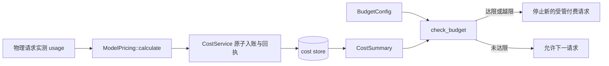

# 成本与预算

## 24. 成本与预算

`CostService` 根据 `ModelPricing` 计算成本并记录 `CostRecord`。当前支持：

- 模型定价表：输入、输出、cache hit token 等维度。
- `record`：写入一笔 token 和成本；已绑定运行 owner 的模型请求逐物理 attempt 入账。
- `summary(session_id?)`：按会话或全局汇总。
- `set_budget`：持久配置日/月预算，提交成功后才返回成功。
- `check_budget`：按已提交的实测费用检查预算；受运行 owner 管理的请求在每次 dispatch 前复用此检查。

### 策略持久化与作用域

预算复用当前 Database 的 `DocumentStore`，唯一事实源为 `settings/cost-budget` 文档；
不依赖内存缓存、登录顺序或 UI 重新设置。新 CostService、独立连接及宿主进程重建后均读取该文档。
这是本地设计：版本 1 保存 CNY、`calendar-day/month`、`host-local`、`cost-ledger` 语义及两个限额，
继续按宿主当前本地时区的自然日/月累计费用，不冻结设置时的时区。

作用域为同一数据库中的成本账本，不是供应商账户额度：切换模型、凭据或重新登录不会清空预算；
换到不同数据库/数据根则拥有独立策略。旧账单不重算，不新增 SQL schema 或数据迁移。
旧进程内尚未持久化的预算无法从磁盘恢复，需要明确设置一次。

- `None` / JSON `null` 表示明确无限，`0` 表示拒绝新的受管模型请求；限额必须是有限、非负数。
- 文档从未存在时，兼容默认为无限；存在但损坏、缺字段、版本/语义不支持或读取失败时，
  `budget`、`summary`、`check_budget` 都返回错误，不静默降为无限，也不自动改写文档。
- `set_budget(BudgetConfig::default())` 是显式清空，保存双 `null`；写入失败不发布新值、也不清掉旧值。
- Rust `set_budget` 返回 `Result<()>`，`budget` 返回 `Result<BudgetConfig>`，调用方必须处理错误。
  Tauri `set_budget` 参数及成功 `CostSummary` wire 形状不变，失败仍返回错误。
  如果提交之后的摘要读取失败，命令会报错，但已保存策略不会回滚。
- 设置是整份策略的原子替换；并发设置以最后成功提交为准，不合并字段、不保证比较版本更新。
  每次准入读取一份策略快照；运行内已提交费用达到日/月限额后，停止新的受管付费请求。
  不提供并发消费预留、费用预测、撤回在途请求或供应商余额保护，不承诺零超支。
  成本记录不依赖策略恢复成功，避免已发生的消费因配置损坏而漏账。
- 不保证降级或混用旧二进制仍遵守持久策略；未挂载 CostService 的入口不因此自动受保护。

实现依据为本仓库已有 DocumentStore 设置持久化和 CostService 准入边界；参考 Codex 的持久预算 owner，
不复制其 token goal 协议。存储字段使用 [Serde 官方字段属性](https://serde.rs/field-attrs.html)
要求两个可空限额字段实际存在，并拒绝未知字段；公共 BudgetConfig DTO 保留原兼容默认值。

### 运行内实测消费与停发

这是基于既有 CallUsageSink / CostService / costs / run_events 的本地设计，不是第二套预算账本：

- 主聊天请求、模型 hook、受该 run owner 管理的子 Agent/压缩，以及工作流文本/embedding 请求，
  在取得用量后按实际模型报价原子提交成本行及请求回执。重试、fallback 各自保留物理请求身份。
- 下一请求检查已提交全局日/月消费，不依赖 UI Usage 回调是否及时消费；等于限额也会拒绝。
  finalizer 只汇总已入账的主请求身份并发送原有单次主费用通知，不再次收费。
- 达限后不撤销已经授权并完成的本地工具结果。需要继续请求模型时，以既有
  `budget_exceeded` 终态停发，保留工具结果与会话；最终回答本身导致越限但不再需要请求时，
  不事后把它改成失败，后续请求仍按预算拒绝。
- 配置预算且当前 run 已有缺 usage、缺报价或失败入账回执时，不能把未知当零来放行。
  已取得的用量及未知状态仍保留；不在这里追溯修正历史账单或预测未返回的用量。
- 尚未挂载该 owner 的独立复核、停滞分类、后台标题/记忆等入口不因此自动受保护，
  其用量归集另见审计 H-63。并发请求可能在彼此费用提交前同时准入，此设计不提供费用预留。

