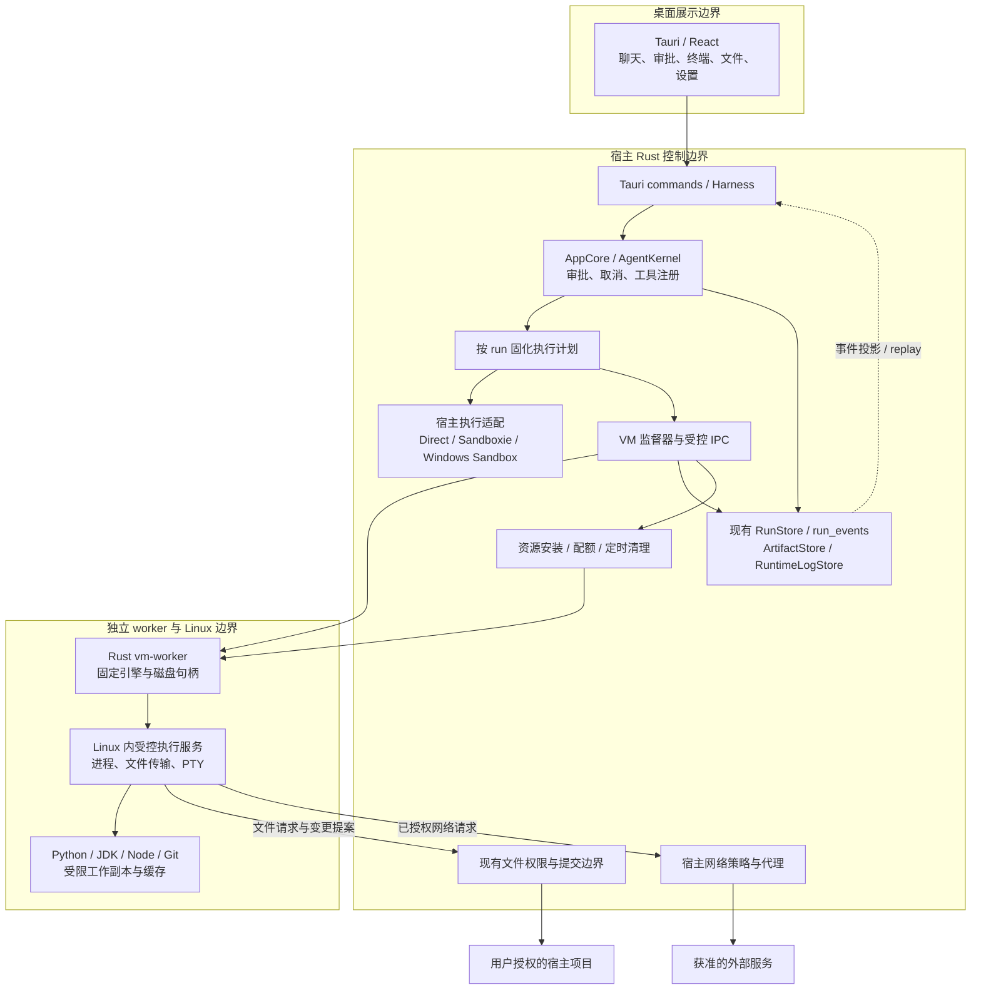
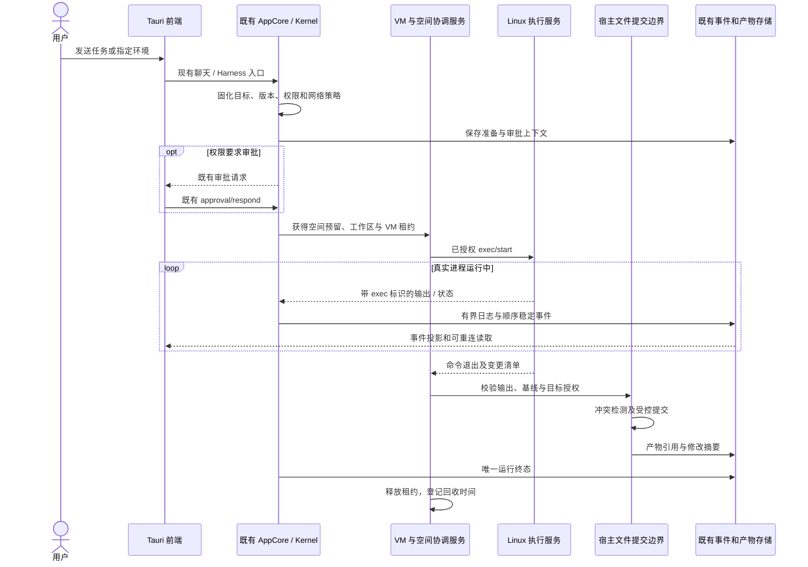

# DeepAgent Studio 内置 Linux 开发环境架构升级方案

> 状态：未来架构设计，尚未接入产品。调研日期：2026-11-09。
> 范围：DeepAgent Studio 当前 Rust/Tauri 架构与独立 VM Lab；不修改业务实现。
> 阅读顺序：本文明确架构和实施顺序；[接口与清理策略附录](G:/Code_Warehouse/DeepAgent-Studio/docs/linux-vm-contracts-and-storage-policy-v1.md)定义拟议契约；[证据与验收索引](G:/Code_Warehouse/DeepAgent-Studio/docs/linux-vm-evidence-and-acceptance.md)区分代码事实、实测与未验收能力。

## 1. 决策与交付边界

采用 **Tauri/React 界面 + 宿主 Rust 控制后端 + 独立 Rust VMM worker + Linux 执行环境**。保留现有 AgentKernel、RunStore、run_events、审批、取消、工具注册、MCP 与终端租约。Linux 是新增执行目标，不是第二个 Agent 系统。

基础安装包携带一个与宿主 CPU 架构匹配的 Linux 环境：Python/pip/venv、完整 JDK、Node/npm、Git、Bash、证书及基础文件工具。依赖包、额外编译器、浏览器、模型和 Office 等大型组件按需提供；不把“有四个基础工具”宣传为“所有项目离线可构建”。

关键约束如下，均作为实现验收条件：

1. 安装包目标仍小于 1 GB；当前独立 Demo 安装包实测为 **313,237,475 字节**，不等于完整产品安装包的测量值。
2. Linux 相关受管资源池默认硬上限为 **3,000,000,000 字节**，约 2.79 GiB；全体项目、任务和 VM 合计，而非每个 VM 各 3 GB。
3. 默认优先使用满足要求且已获宿主执行授权的本机环境；缺失或不兼容时使用内置 Linux。任务执行目标确定后保持稳定。
4. 显式指定 Linux 而不可用时返回错误，不能静默在宿主执行；用户选择宿主同样不能偷偷改成 Linux。
5. 普通文件修改优先走现有宿主文件工具。Linux 命令默认在受管工作副本运行，变更通过宿主检查后回写。
6. 默认禁用 guest 直接网络；联网经宿主策略执行点授权和记录。不能把 `network: true` 当作完整网络权限模型。
7. 清理必须保护活动资源、会话仍引用的结果、用户项目和已交付产物；空间不足时可以明确拒绝任务，不能靠删除用户数据满足上限。
8. 3 GB 不包括用户原项目、应用通用数据库、录音及与 Linux 无关的宿主可选运行时；这些分别展示和治理。Linux 专属缓存、输出暂存及大日志即使放在宿主，也计入 Linux 池，不能通过换目录逃避配额。

以下新增模块名、接口、目录和默认值均为**本地设计**，不代表当前仓库已有这些能力。

## 2. 当前项目可以复用什么

| 当前边界 | 已核实的行为 | 升级方式 |
|---|---|---|
| `SandboxBackend` / `SandboxBackendRegistry` | 提供单次命令、严格 code profile、能力查询；显式隔离后端不可用时拒绝 | 增加 `linux_vm` 后端，继续适配既有 `CommandExecutor` |
| `RunAssembler` / `RunEnvironment` | 按 run 固化执行配置和能力快照 | 在同一准备过程固化执行目标、镜像版本、工作区投影和网络策略 |
| `RuntimeService` | 注册、下载、校验、安装、取消、卸载；活动资源根和兼容查找根分离 | 复用资源生命周期，增加宿主/guest 平台维度及内置镜像激活 |
| `RuntimeBroker` | 解析宿主 Node/Python/Java，支持 `prefer_local`、`local_only`、`managed_only` | 保持宿主路径语义；另由 guest manifest 解析 Linux 工具 |
| `UserPaths` | 默认统一数据根 `~/.deepagent`；`files/runtimes`、`files/cache` 等已存在 | 在同一布局增加 VM 子目录，不改到安装目录写数据 |
| `InstallLedger` | 记录应用安装资源的来源、相对路径和卸载归属 | 记录下载镜像等资源；内置安装资源仍由安装器负责 |
| `ManagedFileInventory` | 把受管文件投影到 SQLite；当前主要统计文件长度 | 扩展分类和分配空间指标，用于核对账目；不能单独充当配额锁 |
| `RunStore` / `run_events` | 持久化状态、事件和唯一运行终态 | 添加 VM 执行上下文和操作证据，不另造 run/event store |
| `ArtifactStore` / 工具结果回收 | 保留仍被历史引用的结果，校验归属后删除 | 承接日志产物、导出文件和过期引用；保留 tombstone 语义 |
| `RuntimeLogStore` | 独立日志写入线程，支持查询；未见通用 TTL/容量回收接口 | 在既有写入者内增加轮转/保留策略，不由 UI 直接删数据库 |
| `TerminalSessionBackend` / 输入租约 | Direct/SSH 共用终端契约，租约带 epoch 防止过期输入 | 后续增加 VM 终端后端，复用租约、光标和接管规则 |
| `fs_guard` / `file_mutation` | 工作区边界、文件身份、先读后改、陈旧读取和提交锁 | 文件导入/导出复用这些边界，不能只做字符串前缀检查 |
| `http_runtime` | 已有 typed HTTP broker，校验公共地址和重定向 | 提取/复用地址策略；不直接把 HTTP 工具当作通用 TCP 隧道 |

当前受管开发工具登记为 Node 24.21.0、Python 3.11.9、JDK 17.0.20+8；Demo 是 Python 3.13.5、JDK 21.0.13、Node 24.22.2、Git 2.47.3。**两者版本不同，切换到 Linux 不是原环境的等价替换。**

桌面端已有 `runtime_list`、`runtime_status`、`runtime_roots`、`runtime_install`、`runtime_cancel`、`runtime_uninstall`、`runtime_migrate_resources` 和 `runtime:progress`。设置页 `ConfigSettings.tsx` 已消费这些能力。CLI 当前参数表没有通用 `runtime install` 子命令，不能在方案中把拟新增 CLI 命令写成现成命令。

当前回收也不是完整定时治理：`AppService` 打开数据库时调用 30 天回收站 GC；桌面还有每 60 秒受管文件 inventory 刷新。**盘点不等于清理，启动时 GC 不等于应用运行期间的定时清理。**

代码与实验的逐项出处见证据索引 E01–E14。

## 3. 总体框架与信任边界



宿主保留模型连接、凭据、会话与权限决策。VMM worker 只负责虚拟化和设备桥接；guest 执行服务只执行已经被宿主授权的任务，不持有第二份业务权限配置。guest 回报是观察材料，不能直接修改审批、运行终态、配额或宿主路径。

主进程不直接调用 `krun_start_enter`：Demo 已证明该入口会接管进程，必须放在独立 worker。生产 worker 建议命名 `vm-worker`，避免命中现有卸载脚本的 `deepagent*.exe` CLI 查找规则；安装器仍应逐步改为精确识别清单中的 CLI。

VM 的复用边界至少包含项目身份、权限 profile、镜像和网络策略。同一时刻最多一个 VM 不代表不同项目可以安全共享同一 guest 状态：跨信任范围切换时排空进程、销毁 guest 并重新启动。按项目/信任范围分配受管数据卷，只附加当前范围的卷，所有卷容量合计仍不得超过池内份额；不能把其他项目的私有卷全部挂进同一 guest。普通命令结束时清理后代进程和句柄，后台能力必须显式续租。

libkrun 官方明确指出，VM 设备可能用 VMM 的宿主权限代理 guest 请求，因此“有自己的 Linux 内核”不能推出“映射任意宿主目录也安全”。必须同时限制 worker 的宿主权限、设备、路径和网络。[libkrun 安全模型](https://raw.githubusercontent.com/libkrun/libkrun/main/docs/security-model.md)

[打开架构图 SVG](G:/Code_Warehouse/DeepAgent-Studio/docs/diagrams/linux-vm/architecture.svg) · [可编辑图源](G:/Code_Warehouse/DeepAgent-Studio/docs/diagrams/linux-vm/architecture.mmd)

## 4. 源码模块怎么划分

| 位置（拟议） | 责任 | 不承担的责任 |
|---|---|---|
| `deepagent-app-core::execution_environment` | 按 run 生成不可变执行计划，协调既有运行时和沙箱注册表 | 不直接 spawn 进程，不自建审批中心 |
| `deepagent-app-core::sandbox_backend::linux_vm` | 实现 `SandboxBackend`，转换既有命令/code 请求 | 不另造 bash 工具或取消树 |
| `deepagent-app-core::vm_service` | worker 监督、启动握手、租约、状态、崩溃恢复 | 不保存另一份聊天历史 |
| `deepagent-app-core::managed_storage` | 统一预留、配额、租约、清理计划和调度 | 不扫描并删除任意用户目录 |
| `deepagent-app-core::workspace_projection` | 授权输入、Linux 工作副本、冲突检测、产物提交 | 不直接复制整个用户主目录 |
| 独立 `vm-worker` 二进制 | 加载固定引擎，附加有界磁盘和 IPC，随监督器退出 | 不接受任意 DLL、宿主 shell 或宿主路径参数 |
| 独立 Linux Rust 执行服务 | 命令/脚本、进程组、文件传输、能力探测及后续 PTY | 不接模型、不决定跨目录授权 |
| 既有 `deepagent-terminal` | 增加 VM backend 实现，沿用会话/输入租约 | 不复制 xterm 与终端协议 |
| Tauri/React | 环境选择、配额设置、审批、事件和结果展示 | 不直接调用 VMM、宿主 shell 或 guest RPC |

初期在 AppCore 现有模块内实现协调服务。只有 VMM 隔离、Linux 目标编译和 ABI 边界需要独立二进制/小型协议库；不要一开始拆成大量 crate。

## 5. 如何选择用户本机与内置环境

将两个问题分开：`executionTarget` 决定命令在哪里执行；`runtimePreference` 决定在该目标内使用哪套工具。现有 `RuntimePreference::ManagedOnly` 目前表示宿主管理的可执行文件，不应悄悄改成“Linux VM”。

| 输入条件 | 行为 |
|---|---|
| 用户指定 Linux VM | 探测 VM、镜像及工具版本；不满足则拒绝，提供诊断 |
| 用户指定宿主或解释器路径 | 校验宿主授权、路径和版本；不满足则拒绝 |
| 自动模式，宿主版本完整且获得宿主执行授权 | 固化为宿主任务，沿用当前本地优先策略 |
| 自动模式，宿主缺少工具或版本不兼容 | VM 可用且满足要求时固化为 Linux；显示选择原因 |
| 只有部分宿主工具匹配 | 不按每条命令随意混用；整个构建任务选择完整目标 |
| Windows 原生应用、Xcode、系统服务或真实桌面操作 | 显式宿主能力，或对应专用远程/设备后端 |
| 所有目标均不可用 | 返回缺失项；安装、启用组件或云端执行必须另有用户选择 |

“已经安装某工具”是能力事实，不是执行授权。只读权限配置不能因为检测到本地 Python 而自动运行宿主脚本。配置在运行中改变也不修改已批准任务；重新准备任务、重新生成快照后才应用。

本机是否“完整满足”以任务所需能力集合判断，不要求一个只用 Python 的任务也必须安装所有语言。除了版本，还要检查该任务需要的 pip/venv、JDK 编译能力、包管理器等；现有仅 `--version` 的探测不足以证明这些能力。Host Direct 的边界是当前用户的系统权限，文件工具的 workspace 检查不会自动限制宿主 shell 的内部文件访问；界面和审批必须如实说明选中后端的实际隔离能力。

宿主 Windows Python、`.venv`、`node_modules`、JDK 不作为 Linux 二进制使用。VM 的工具清单来自签名镜像 manifest 与启动后的实际版本探测；项目依赖按 OS、架构、解释器 ABI、锁文件和源配置隔离。

## 6. 每一类现有功能如何接入

| 功能 | 未来路由 | 迁移要求 |
|---|---|---|
| Agent bash、构建、测试、Git CLI | 既有工具 → `CommandExecutor` → 选定 `SandboxBackend` | VM 内 shell 是 Bash/Sh；不能复用 `CommandShell::Wsl` 来实现原生 VM |
| Python/JavaScript 工作流 code 节点 | 既有严格 `execute_code` profile → guest SDK | 当前 `SandboxCodeRequest.runtime` 是宿主路径；需显式引入 guest runtime 描述，不能伪造宿主路径 |
| 读/写/编辑/移动文件 | 既有宿主文件工具 | 命令产生的文件修改经相同权限和提交边界回写 |
| 交互终端 | `TerminalSessionBackend` 的 VM 实现 | PTY、resize、signal、接管、断线光标均通过验收才声明支持 |
| stdio MCP | 现有 MCP registry/client → 目标感知的进程传输适配 | 保留请求相关性、重连预算、catalog generation；VM 回收不能错误重放有副作用调用 |
| HTTP MCP、web fetch、模型 API | 既有宿主连接及网络权限 | 不因加入 VM 把凭据和模型调用迁入 guest |
| 插件的 Node/Python 子进程 | 按插件能力声明选择 host 或 guest | 原生插件/宿主桥接可继续使用受管宿主运行时；不可声称 VM 自动覆盖所有插件 |
| hooks、验证命令 | 对目标明确的进程调用进入同一执行适配 | 宿主生命周期 hook 与 guest 项目 hook 分开，不让项目脚本获得宿主权限 |
| Office、PDF、音视频、浏览器、SSH、移动设备 | 保持原服务边界；按能力逐项迁移 | 大型运行时仍按需下载；不塞入基础 Linux 包，也不直接复用跨 OS 原生库 |
| CLI、SDK、app-server | 复用同一 AppCore 配置与执行准备过程 | 不能只在 Tauri commands 里实现 VM，使 CLI 永远绕过它 |

迁移时全局核对 `Command::new`、`tokio::process::Command`、PTY spawn 和插件/MCP launcher。不是机械地把每个进程移进 VM，而是为每个入口标注执行域、授权来源、环境和审计归属。

## 7. 安装包与用户目录

### 7.1 不改变现有数据根约定

应用数据默认继续使用 `UserPaths`：Windows 为 `%USERPROFILE%\.deepagent`，macOS/Linux 为 `~/.deepagent`；已有 `DEEPAGENT_DATA_ROOT` / `DEEPAGENT_DB_PATH` 的作用保留。不要同时新增一个 `%APPDATA%` 主数据根导致 CLI/Desktop 各存一份。

安装目录由安装器和 Tauri `resource_dir` 解析，不能硬编码：Windows 一般位于用户选择的安装目录，macOS 在应用包资源目录，Linux 随包格式解析。安装目录只放程序与随包资源；运行数据写入 `UserPaths`。这是 Tauri 官方资源 API 的使用边界。[资源打包与路径解析](https://v2.tauri.app/develop/resources/)

### 7.2 推荐目录布局（新增项为本地设计）

```text
应用安装资源目录/
  vm-worker[.exe]                 # 宿主架构对应的可信 worker
  vm-engine/<host-os-arch>/       # 固定版本引擎/固件及许可证
  vm-seed/<guest-arch>/           # 压缩基础镜像、签名 manifest、SBOM
  plugins/ mcp/ skills/ sandbox/  # 当前已有的随包资源

UserPaths.root/
  deepagent.db                   # 现有会话、run/events、权限与控制元数据
  runtime-logs.db                # 现有诊断日志；增加保留策略
  install-ledger.json            # 现有安装归属清单
  files/
    runtimes/                    # RuntimeService 默认活动根
      sdk/                       # 保留现有宿主 Node/Python/JDK 等
      linux-vm/images/<digest>/  # 已校验、已激活的只读 guest 基础镜像
    vm/                          # 新增：跨项目共享的 Linux 管理数据
      volumes/<volume-id>/data.ext4
      control/<boot-id>/          # ACL 私有，启动握手/控制材料，不暴露给任务
      exports/<exec-id>/          # 宿主校验前的有界输出暂存
      locks/                     # 跨进程租约与维护锁
    cache/vm/
      downloads/<install-id>/     # 有上限、可恢复的压缩资源暂存
      staging/<install-id>/       # 校验/解压期间的独立 staging
      scripts/<exec-id>/          # 有期限、受限权限的脚本原文
    tool-results/                # 复用现有结果产物根；VM 日志按 exec 分类
    artifacts/                   # 已提交结果的既有产物管理
    attachments/ recordings/     # 原功能数据，不是 VM 垃圾
  plugins/                       # 当前插件状态与运行数据布局保持兼容

用户选择的项目目录/              # 用户文件，不由 VM 垃圾清理器删除
```

自定义运行时根时，镜像安装位置跟随 `RuntimeService.install_root()`，来源仍登记在统一安装记录。所有位置通过路径对象解析，不拼接用户输入成为绝对路径；资源池按已登记资源 ID 计量，不能只扫描某一个目录就漏算迁移后的文件。

随包 seed 位于安装目录，由安装器管理；激活后生成在用户数据根的基盘、卷和缓存则登记为有归属的派生资源，不能因来源是 bundled 就漏出清理/卸载记录。

控制目录、脚本、原始日志和下载认证信息只允许当前用户及所需服务访问。不得把凭据、控制 socket、用户数据根或整个系统盘挂入 VM。资源根迁移需要停止 VM、检查卷类型和路径身份，原子切换后再更新索引；不自动跨 UNC/网络盘运行块磁盘。

### 7.3 Linux 内部布局

```text
/                               # 只读基础系统与四套工具
/opt/deepagent/guest-agent       # 固定版本 Rust guest 执行服务
/data/workspaces/<scope-id>/     # Linux 语义的受管工作副本
/data/envs/<environment-id>/     # venv、项目依赖、用户前缀安装
/data/cache/                    # 可再生的 pip/npm/Maven 等缓存
/data/home/<scope-id>/           # 独立 HOME，禁止跨任务自动读 rc/凭据
/run/deepagent/                 # 有上限的内存控制区，任务不可写宿主授权记录
/tmp/                          # 有上限的 tmpfs；不写 guest swap 文件
```

缓存与已安装环境必须区分：下载缓存可淘汰，活动 venv、`node_modules`、当前编译输出不能一律按“垃圾”删除。源码、依赖和生成物保持 Linux 大小写、符号链接、执行位语义；导出到 Windows 时单独做可表示性检查。

## 8. 首次安装、启动、升级与卸载

1. 安装器部署前端、宿主 Rust、worker、引擎、压缩镜像和 manifest；不修改用户全局 PATH，不默认安装 Docker/WSL 发行版。
2. 第一次使用 VM 前，宿主做平台/架构/虚拟化能力、资源完整性、空间预算和数据根检查。UI 先可用，解压和磁盘扫描在后台运行。
3. 对随包镜像执行“离线激活”：先预留压缩文件、解压上限、基镜像和 staging 的同时占用，再校验和发布。不要把离线激活伪装成一次网络下载。
4. 启动 worker 并完成协议、镜像、guest 工具和能力握手。只在真正成功后标记 ready；文件存在和 `HypervisorPresent=true` 都不是完整启动证明。
5. 空闲 180 秒后关闭 VM 的默认值可配置；保留需恢复的受管数据卷和输入租约元数据，不默认保存内存检查点。
6. 镜像升级采用 digest 不变目录、租约排空、签名/哈希验证和原子 active 切换；一次运行固定镜像。不能运行中覆盖 DLL 或磁盘。
7. 更新前计算旧镜像、新下载、新解压及回滚资源的峰值。达不到 3 GB 上限时先清理可回收项；仍不够就延后升级，不临时放宽硬上限或先删唯一可用镜像。
8. 卸载继续利用安装归属和现有卸载链：先停止/回收活动 worker，删除应用拥有且允许移除的 VM 资源；聊天、设置和用户文件遵循现有独立选择。失败的清理留下可重试记录。

Windows 原生路线依赖系统虚拟化能力，不要求 WSL 发行版；缺失组件或 BIOS/UEFI 虚拟化不可用时不能承诺安装包独自解决。启用系统组件可能要求管理员和重启，必须由用户选择。当前官方平台表还限制宿主/guest 架构匹配、Intel Mac 支持等。[平台要求](https://smolmachines.com/docs/introduction/concepts/supported-platforms)

Windows x64 是本次 Demo 的原生实测目标；Linux/KVM 的历史实验经 Docker/WSL 进行，不等于 Linux 原生安装器验收；Apple Silicon、Windows ARM64、Intel Mac 和未安装 WSL2 的干净 Windows 分别列入验收矩阵，不推断通过。

本轮盘点现有桌面 `resources` 四类文件合计约 107.23 MB（plugins、MCP、skills、sandbox），还未计应用二进制、前端和安装器压缩。它说明完整产品需要重新建立打包预算，不能直接拿 Demo 的 313 MB 作为产品安装包大小。发布需携带引擎/固件/guest 工具的许可证、来源、对应构建信息和 SBOM。

## 9. 一条命令的完整执行过程



命令执行前必须具备 `runId/actionId/execId`、目标与镜像标识、工作区投影、批准的权限/网络策略、版本清单、取消上下文和空间预留。将现有 `ToolExecutionContext` 的取消与 deadline 传到底，不再增加一套独立任务超时。

[打开执行时序图 SVG](G:/Code_Warehouse/DeepAgent-Studio/docs/diagrams/linux-vm/execution.svg) · [可编辑图源](G:/Code_Warehouse/DeepAgent-Studio/docs/diagrams/linux-vm/execution.mmd)

脚本通过受控传输发送原文和摘要，由 guest 落到当前任务目录并执行；argv 是结构化数组。宿主不拼接 PowerShell/cmd 来承载 Linux 命令，也不把任意脚本放进 VMM 内核命令行。Demo 已出现过 libkrun argv 折叠时引号破坏的问题。

stdout/stderr 使用独立数据流或带长度的二进制帧。Rust 在写入前执行字节预算、脱敏和背压；原始输出按权限存宿主，UI 与模型只拿有界结果。UTF-8 跨帧要保留未完成字节，不能损坏中文或把非法字节无限重试。

取消先发送进程组信号，短暂宽限后回收整组；guest 不响应则停止所属 worker。必须确认实际子进程/磁盘租约结束后才回收文件。取消和崩溃不能把收到的部分输出误算为成功；Kernel 仍是唯一终态写入者。

后台服务、MCP 和 PTY 必须拥有独立的存活租约和有期限网络/端口授权，不能在普通命令返回后偷偷继续占用资源。第一阶段默认最多一个活动 VM 与一个互斥工作执行槽；多 Agent 排队使用，父任务等待子任务时不得持有阻塞子任务的 VM 槽。

## 10. Linux 如何操作用户文件

### 10.1 默认采用宿主权威文件加 Linux 工作副本

用户项目是宿主的权威数据。Rust 根据 workspace 与读权限创建文件 manifest，包含相对路径、内容摘要、类型、大小和版本基线；按需导入到 Linux。默认排除凭据、应用控制目录、无关大型缓存、Windows 依赖目录和未授权子树。

简单读写继续走现有 `read_file/write/edit/move` 类工具，无需为它们启动 VM。需要 Linux 编译语义的命令使用工作副本。允许用只读 virtiofs 加速输入，但不把 Windows 目录的语义当作 Linux ext4；需要时复制到 guest 工作区再运行。

Rust 为 guest 签发不透明的 workspace/file handle。guest 请求不能自行填写 `C:\`、`/Users/...` 或任意宿主路径。跨 workspace、外部文件夹和导出目标都必须有明确授权。

### 10.2 文件回写是一项宿主受控提交

任务结束后，guest 提交新增/修改/删除的相对路径和候选数据。Rust 执行以下步骤：

1. 按上限读取产物，拒绝越界路径、设备文件、ADS、保留名称、链接逃逸和不受支持的 Windows 文件名。
2. 对照导入时的文件摘要和当前宿主文件身份。用户运行期间修改了文件时报告冲突，不覆盖。
3. 判断已有写授权是否涵盖精确目标及变更；需要时通过既有审批路由展示 diff。
4. 复用 `fs_guard`、观察版本和 `fs_commit` 路径锁进行 staging/原子替换；更新原文件工具的观测缓存。
5. 多文件提交保留操作日志与逐文件结果。普通文件系统不能承诺任意多文件替换天然具备数据库事务原子性；中途失败要可恢复并报告部分提交。
6. 在既有 ArtifactStore 和 run_events 保存修改摘要、产物引用及实际提交结果。

命令获准执行不自动等于所有宿主修改获准；反过来，已经批准的精确写范围不必为每个小文件重复询问。授权必须在宿主验证，guest 的“已批准”字段没有效力。

为保持目标文件替换的原子性，必要时在目标父目录由宿主文件边界创建 staging 文件，登记精确身份与删除归属，而不是扫描清理整个用户目录。未发布的 staging 即使在用户项目所在磁盘也计入 VM 临时预算；发布后才作为用户持久产物管理。大文件无法容纳时明确拒绝，不借临时输出名绕过 3 GB。

### 10.3 直接可写挂载是独立高级能力

默认不采用整个项目的可写 virtiofs。只有用户明确选择、后端确实支持并且路径审计与写入影响得到解释后，才能授予指定子目录直接写权限。该模式不能承诺逐文件审批、自动回滚或完全记录每个写系统调用；界面必须与默认工作副本模式区分。

跨 Windows/Linux 的大小写冲突、冒号名、符号链接和权限位需要可见诊断，不能默默改名或丢失信息。`.git` 修改、分支切换、重命名和二进制产物同样进入冲突/回写测试。

## 11. 网络与密钥边界

宿主模型 API、下载器、HTTP 工具和 guest 出网是不同授权范围。用户允许模型联网不等于 Linux 可以访问局域网或本机管理端口。

默认网络路径为：guest 工具 → guest 本地代理适配 → 独立受控 IPC → 宿主 egress broker → 获准目的地址。guest 不配置可绕过 broker 的直接网络设备/TSI INET 能力。代理地址环境变量只是客户端适配，不是安全执行点。

宿主 egress broker 必须执行域名/地址、端口、协议、有效期、调用范围和字节预算；默认拒绝宿主 loopback、私网、链路本地、云 metadata、IPv6 特殊范围及未经验证的地址转换。DNS 与连接绑定在宿主，重定向逐跳重验，防止 DNS 重绑定。复用 `http_runtime` 已有地址判断，通用 CONNECT/TCP 的授权和隧道计量需另行实现验证。

默认开放能力按批准列表提供公共 HTTPS；包管理器需分别配置其支持的代理方式。不假定 Node、Java、pip、npm、Git 都自动遵循同一环境变量。无法走已验证代理的客户端明确报错，不能自动放开 guest 直连。

各次出网授权绑定 worker generation 和执行信任范围。串行任务结束时撤销授权，不能让上一个项目的代理凭据或允许列表残留到下一个项目；实际连接字节由宿主计量。共享包缓存只保存可校验、可再生的包内容，不共享 `.npmrc`、Git 配置、认证缓存或用户 HOME。

下载脚本、依赖安装、Git push 都走现有风险与权限判断：`Permission::Network` 是必要条件，不替代 `GitPush`、`Secrets` 等授权。依赖安装器仍是在执行第三方代码，其宿主写入能力不能扩大。

默认不把 DeepSeek/API Key、SSH agent、浏览器 cookie、用户 Git 凭据和整套宿主环境变量传入 VM。确需认证时使用一次性/短期授权或宿主受控请求；凭据不进入命令行、普通日志、镜像或缓存键。

需要预览 guest Web 服务时，单独签发端口租约，通过宿主 loopback 的受控转发访问指定 guest 端口；默认不监听宿主 `0.0.0.0`，不开放任意反向隧道，任务结束撤销。公开开发服务器需要额外明确授权。

当前 Demo 的“网络允许”测试仅为显式放行的本机测试服务，证明了这一条通路，未证明公网 DNS/TLS、代理、证书和全部包管理器已通过生产验收。

## 12. 3 GB 资源池与磁盘设计

### 12.1 先定义计量口径

Linux 资源池包括：随包 VM 压缩资源与引擎、激活镜像、可写卷、guest 环境与依赖、导入工作副本、Linux 专属下载/解压暂存、未交付导出、脚本原文与大日志。相同实体只计一次，不能同时把 data 卷与其内部缓存再加一次。

普通安装程序本身留在用户下载目录的副本不由本应用自动删除；UI 可说明其占用。应用通用 SQLite、用户项目和宿主可选 Office/语音模型另计并展示。Windows 文件系统元数据、系统还原、pagefile 和其他进程占用不属于可由本应用保证的 3 GB。

计量同时报告 `logicalBytes`、`allocatedBytes`、`reservedBytes`、`reclaimableBytes`、guest 文件系统可用空间和 inode 用量。准入以受管文件的分配上界和未完成写预留为依据，不把稀疏文件的当前物理小体积当作未来可无限增长的许可。

### 12.2 推荐生产形态：只读基盘加有界 raw 数据卷

Demo 的 ext4 + qcow2 验证了可行性，但“在 guest 中删文件”不能保证宿主 qcow2 自动缩小。生产默认建议改为只读基础 ext4 + 固定最大长度的 raw ext4 数据卷；任务工作副本、环境和缓存都放在数据卷里。root 保持只读，`/run`、`/tmp` 使用有上限 tmpfs，关闭 guest swap 和默认内存 checkpoint。

guest 无权调整块设备容量、追加新卷或直接写宿主路径。worker 打开受管磁盘的方式与长度必须验证，raw 卷文件不能随 guest 写入继续增长。这样即使任意脚本忽略应用约定，最多耗尽数据卷，不会无限膨胀宿主磁盘。

以下是**待打样验证的生产预算**，不是现有 Demo 已实现的体积：

| 类别 | 默认预算上界（十进制 MB） | 说明 |
|---|---:|---|
| 随包压缩镜像 | 350 | 安装资源中保留的副本也计入 |
| 引擎、固件、guest 组件增量 | 60 | guest 组件若已在镜像内不得重复计量 |
| 激活的只读基础镜像 | 1,000 | 需缩容及版本兼容实测才能定版 |
| 全部可写 raw 卷 | 1,000 | 含工作副本、环境、缓存及 ext4 自身开销 |
| 宿主 VM 大日志与执行原文 | 100 | 全局聚合上限，单次输出另有限额 |
| 下载、解压、导出等临时文件 | 300 | 有预留才允许写，下载与解压不重复占预算之外空间 |
| 弹性/事务与控制预留 | 190 | 高压时保留终态、清理和恢复所需空间 |
| **总计** | **3,000** | 全部 VM 共享，不是每个任务一份 |

预算是同一池内的分配方案，升级可在无活动租约时调整份额，但总量不能突破硬上限。默认 raw 卷内部可按工作副本、可再生缓存、已安装环境设置子配额，防止单个包管理器挤占全部空间；块、inode、临时内存分别计量。

当前实测基础磁盘仍为 2,147,483,648 字节，已用约 781 MB。它能在严格压低其他资源时进行有限实验，但**不能套上上述生产预算并宣称完成**。基础镜像缩容、只读启动、raw 数据卷与非 root 执行均是发布前门槛。

### 12.3 硬上限不能只靠定时清理

`ManagedStorage` 为并发的安装、导入、日志写入、导出和新卷分配执行原子预留：

```text
本次已承诺上界 = 已发布受管文件的计量值 + 未完成写入的预留上界
允许写入条件   = 本次已承诺上界 + 新增预留 <= 3,000,000,000
```

固定 raw 卷按最大文件长度预留；日志和流式下载按有界块预留，不信任 Content-Length。校验失败、取消和崩溃后的预留要经过实际文件/进程核对才能释放。所有写者必须参与同一机制，不能留一个 legacy 下载器或输出文件可绕过上限。

配额账本的预留不等于宿主磁盘真的有足够空闲。还须按所在卷检查可用空间，验证 raw 文件的实际分配行为并保留控制余量；其他软件把磁盘写满时明确报告宿主空间不足，不扫描删除其他软件或用户文件。

镜像安装校验压缩包大小、展开后大小、文件数、链接与路径；预留不足不得开始。引擎若无法证明 raw 文件有界或仍使用未经验证的可增长 qcow2，就不能对外承诺严格 3 GB。

### 12.4 两种压力分别处理

| 压力源 | 默认阈值 | 自动行为 |
|---|---|---|
| guest 数据卷已用达到 70% | 以 guest 实际可用块/inode 为准 | 后台淘汰无租约缓存，目标降至 60% |
| guest 数据卷达到 85% | 同上 | 加强清理、暂停新依赖下载/工作区导入，展示可回收与被保护部分 |
| guest 数据卷达到 95% | 同上 | 拒绝新的写入型任务，必要时通过 Kernel 有序取消持续写入任务 |
| 宿主 Linux 池达到 85% | 3 GB 计量口径 | 清理过期日志、暂存和旧资源；不指望删 guest 缓存缩小固定 raw 文件 |
| 宿主 Linux 池达到 92% | 同上 | 停止新下载/新卷/升级，触发一次有界维护 |
| 任一写入将超过硬上限 | 写入前检查 | 拒绝写入并返回结构化原因；绝不先写满再清理 |

固定 raw 卷内部清理释放 guest 可用块，但宿主文件长度不缩小。这是预算内复用，不是宿主空间回收。需要降低宿主占用时，停机后回收整个无引用卷，或运行经过验证、带峰值预算的离线重建；不能承诺靠定时 `fstrim` 自动完成本链路回收。

数据过大或所有内容都被活动任务/恢复历史固定时，显示 `QuotaExceeded` 和不可回收原因。用户可选择缩小输入、移除不再需要的保留环境或显式使用宿主；系统不自动切换执行目标。3 GB 是轻量开发配置，不保证容纳浏览器、完整容器镜像、大型依赖树和多个大项目。

## 13. 定时清理与默认设置

统一调度放在 Rust AppCore，Desktop/CLI 共用，不由 React 的 `setInterval` 负责。默认计划：

- 应用启动完成 30 秒后补做过期清理；打开期间每 15 分钟运行一次，错过的周期合并处理。
- 任务结束后 60 秒内合并一次轻量清理；空间压力事件立即触发有界清理。
- 活动任务每 5 秒采集快速空间指标；全量文件盘点在后台、空闲时核对，不能阻塞 UI。
- 应用完全退出时没有后台守护进程替它继续执行；下次启动补做。后续若要常驻系统服务，需作为独立产品能力选择。

默认保留规则、配置范围、清理算法和恢复流程见附录。概括如下：

| 数据 | 默认保留 | 压力清理 |
|---|---|---|
| 成功任务完整 stdout/stderr | 3 天 | 可以提前淘汰原文，但保留摘要和过期标记 |
| 失败/取消任务完整日志 | 7 天 | 优先保留；仍受全局容量与用户固定规则约束 |
| 已完成任务临时脚本/输入副本 | 30 分钟 | 无租约、已完成必要提交后可立即回收 |
| 失败任务的可恢复工作副本 | 24 小时 | 有恢复/固定引用时不删，过期后删除前校验状态 |
| 包下载缓存 | 7 天未使用 | LRU 清理，排除活动依赖安装和已安装环境 |
| 失败/中断下载暂存 | 24 小时 | 没有存活安装租约时可提前删除 |
| 不再引用的镜像/数据卷 | 默认 24 小时回滚窗口 | 无活动/恢复/回滚引用时才回收 |
| 操作摘要、权限和清理审计 | 默认 90 天最低保留目标 | 不等同于 90 天后自动删除仍可见会话的 run_events |

审计目标受日志总量上限约束，不能无限固定：容量不足时阻止新执行或要求用户管理保留项。会话事件按原历史/replay 策略保留；清理器不单独删除某个活动 run 的中间事件。

执行清理要经过 `plan → 校验资源身份与引用 → 标记清理意图 → 关闭/释放实际资源 → 删除 → 更新原索引 → 记录实际回收量`。崩溃后可重试；已替换路径、软链接/junction、陌生文件和仍在使用的卷都不删除。

`InstallLedger` 管安装归属，`ManagedFileInventory` 管观测投影，`ArtifactStore` 管产物及引用，新增的预留/租约状态扩展同一数据库的控制能力。不能另外建一套 JSON 清理目录清单与它们争夺所有权。

当前 `HostRole` 的故障兼容行为不能直接作为删除授权。维护者还必须拿到明确的跨进程独占维护锁和资源级租约；锁失败就跳过维护并报告，不能“假定自己是 primary”后执行删除。

## 14. 执行记录与审计的完整性

每次执行至少记录：run/action/exec 标识、执行目标、配置快照、镜像和工具版本、脚本摘要及受控原文引用、工作目录 handle、输入文件基线、权限/审批标识、网络策略、开始/结束/退出/信号、输出截断情况、宿主实际提交的文件变化、空间前后值及清理原因。

宿主负责“派发了什么、授权了什么、导入/导出了什么、代理连接到哪里、何时终止和清理”的可信记录；guest 提供命令输出及内部观察。不要把 guest 可写的 `done.json/exit.txt` 当作审批或配额事实。Demo 的退出码文件适合验证普通程序，不构成防恶意篡改的控制通道。

完整日志原文与审计摘要分开。原文可能包含凭据和用户内容，按当前脱敏设施、访问权限和 TTL 管理；只对安全元数据做长期诊断。清理后 UI 显示“原始日志已过期”，仍可看到命令摘要、版本、退出状态、产物和清理时间；不能显示成“从未执行”。

审计覆盖范围必须诚实：上述方案可覆盖宿主授权的操作与跨边界副作用，不等于记录脚本每一个内部 syscall。若产品要求全量 guest 子进程/文件调用取证，需要额外验证内核审计能力、性能和防篡改条件，不能用 shell history 代替。

关键审计写入失败时，不启动新的高风险操作；执行中无法保留终态时保留预留控制空间并有序停止。唯一终态由既有 Kernel/RunStore 生成，guest 退出、worker EOF、超时和用户取消的映射在适配层显式测试。

## 15. 接口与前端应该怎么调用

保留原有聊天、审批、Harness 和运行时安装接口。新接口只解决环境状态/准备与存储治理；不能新增一个可绕过 AgentKernel 的“前端直接运行任意宿主命令”入口。

前端展示环境标签、来源、实际版本、选择原因、VM 状态、空间分类、被固定资源、清理计划、最近清理结果及不可清理原因。设置页复用现有 shadcn 组件和运行时管理页，不另开第二套环境管理产品。

Tauri `invoke` 是 UI 传输；权限、版本、路径、配额和配置校验在 Rust 重做。Harness 的 `config/read`、`sandbox/status` 及版本化 capability 投影同一个 AppCore 状态；新能力未实现时不在协议里宣称可用。guest 控制协议与 Harness machine protocol 分别版本化。

具体拟新增 commands、DTO、guest RPC、错误码、设置样例和一次文件任务调用示例见[接口附录](G:/Code_Warehouse/DeepAgent-Studio/docs/linux-vm-contracts-and-storage-policy-v1.md)。所有示例明确为设计契约，不是当前可运行 API。

现有 Tauri 配置为 `csp: null`、asset scope `**`，增加 VM 能力前应梳理本地预览资源授权与窗口级能力。远程网页或插件预览不能继承主窗口的管理接口；CSP/asset 收紧要兼容现有预览功能，不能一次粗暴关闭。Tauri capability 不是业务权限模型的替代品。[Tauri 安全能力](https://v2.tauri.app/security/capabilities/)

## 16. worker、guest 与平台可靠性

生产 guest 执行服务优先 Rust，不依赖宿主 Python。启动特权只用于配置磁盘、受限目录与进程控制；普通任务降为非 root，清理 Linux capabilities，禁止访问控制通道和宿主凭据。

默认 root 只读；项目通过 pip/venv、npm、Maven/Gradle 等受管用户前缀使用依赖。任意 `apt install`、系统服务或 root 包安装不是默认能力；需要它们时提供经过验证的附加组件/镜像版本或显式额外 profile，仍受 3 GB 上限约束。

初始资源建议沿用 Demo 的 2 vCPU、1536 MiB RAM 作为待调优起点；进程数、文件句柄、输出速率、guest 内存和临时目录另外限额。Linux cgroup v2 可作为进程组资源执行点，但必须先探测所发内核控制器，不能仅凭文档就把支持位设为 true。[cgroup v2 官方说明](https://docs.kernel.org/admin-guide/cgroup-v2.html)

宿主 worker 需随监督器退出而回收：Windows 采用经验证的进程 Job/句柄生命周期，Linux/macOS 使用相应进程监督。不得只依赖 UI 的取消按钮或 Rust future 的 Drop；真实后代进程、继承句柄与异常断电恢复都进入测试。

libkrun 2.0 `main` 的 ABI 仍在变化，不能用“当前 main 的头文件”推断任一已下载 DLL 的完整 ABI。发布必须锁定引擎二进制摘要、准确源码 commit、头文件、固件和 guest 协议版本；所需 Windows 导出、HANDLE 参数和块设备行为要逐项测试。若无法建立来源与 ABI 对应关系，停止把该组合推入正式安装包。[libkrun ABI 状态](https://github.com/libkrun/libkrun/blob/main/README.md)

Demo 使用的 smolvm Windows CLI 控制链曾失败；当前原生成功依赖直接 libkrun C ABI，不应描述成“smolvm Windows SDK 已完整验证”。可保留驱动适配层以便后续切换经验证的稳定引擎，避免业务层依赖某个 CLI 私有参数。

## 17. 实施阶段、门槛与回退

| 阶段 | 实施内容 | 必须拿到的证据 |
|---|---|---|
| P0：固定实验基线 | 锁定准确 ABI/来源；补干净 Windows、无 WSL2、缺虚拟化场景；测 raw 数据卷/只读 root/非 root/双向通道 | 平台日志、二进制摘要、命令真结果；不满足则 VM 标记不可用 |
| P1：镜像与空间 | 生产基础镜像缩容；包签名与 SBOM；3 GB 原子预留；raw 卷硬容量；升级峰值预算 | 压缩/展开/峰值/写满/取消/断电测试；证明任何写者不能越限 |
| P2：单次命令闭环 | `linux_vm` 后端、运行准备与能力快照、既有审批取消、日志和审计、工作副本及提交 | CLI/Desktop/Harness 同一任务夹具；真实文件冲突与唯一终态验证 |
| P3：开发与交互能力 | 四套开发工具、网络代理、依赖、Git、PTY、端口预览、目标感知 MCP/插件/hook | 各能力独立支持位和实机测试，不支持的能力明确拒绝 |
| P4：存储治理与设置 | 定时/压力清理、租约、配置 UI、历史过期展示、资源迁移与卸载 | 并发与重启测试；不会删除活动资源或用户文件；清理量真实 |
| P5：逐平台发布 | Windows x64 → Linux → Apple Silicon；其他平台独立评估 | 真安装器、离线首次用、升级/回滚/卸载、低磁盘和安全边界验收 |

在实现 P1/P2 时就加入最低限度清理与审计，不能先上线无界写入再等 P4 补救。P4 是完整治理和 UI，而不是第一次加入删除保护。

回退只改变未来任务的可选目标；已经批准 Linux 的 run 不自动转宿主。旧 Direct/Sandboxie/Windows Sandbox 继续存在；新配置缺省兼容旧文档，显式 `linux_vm` 在旧客户端必须报告不支持。资源更新失败保留旧 active 指针，不能写出“已升级”假状态。

每个阶段检查共享契约的 Rust/TypeScript、Tauri 注册、CLI、Harness、持久化和 replay 消费者；新增后端或事件字段时采用显式版本/兼容策略，不能只改桌面 UI。

## 18. 测试范围与完成判据

详见[验收矩阵](G:/Code_Warehouse/DeepAgent-Studio/docs/linux-vm-evidence-and-acceptance.md)。最低发布门槛包括：

- 无 WSL2 的干净 Windows 真安装；WHP 不可用/虚拟化关闭/普通用户/需要重启场景诊断。
- 前端 invoke/审批/事件/replay → Rust → Linux → 四套工具 → 受控文件回写的真实闭环。
- 进程启动失败、退出 23、信号、Unicode/二进制输出、超时、取消、后代、崩溃、异常关机和重连。
- 数据卷、inode、输出、下载、导出、并发安装、历史固定、升级双版本与解压炸弹压力下不突破 3 GB。
- 目录穿越、软链接/junction、链接替换、Windows 命名冲突、用户并发编辑和跨 workspace 权限失败时不误写。
- 禁网、允许域名、DNS 重绑定、重定向、IPv6、loopback/私网、代理认证、证书及各包管理器实测。
- 定时/压力/手动清理同一实现；重启后重试；活动租约、会话引用、用户文件及产物受到保护。
- 原内核已有测试、桌面类型/构建与相关手动验收继续通过；不能用 Demo 19 项通过代替全产品验收。

## 19. 本轮交付与证据解释

本轮交付是可审查的架构、接口、存储策略、实施阶段和验收清单。新增 API、3 GB 硬限额、生产 raw 卷、定时清理和 VM 后端接入均未在业务代码实现。

Demo 当前能证明原生 Windows 上的真实 Linux 命令、四套工具、文件语义及部分控制能力；它采用的 root/网络/文件回执与工作目录设计仍属于实验。正式版本以 P0–P5 的明确证据推进，不把当前实验可用等同于全部产品能力可用。
