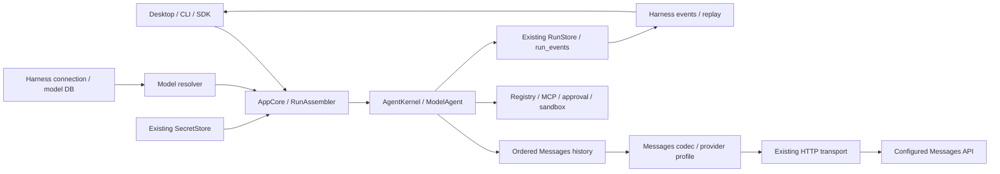

# 用 Messages 全面替代 Responses：调研记录与实施方案

调研日期：2026-11-14。基线：当前工作树（存在用户未提交的模型、上下文、运行时修改），HEAD `c570dec7`。本文按查证批次增量写入，保留证据、发现和实施路径，不以既有审计报告代替源码核对。

**决策摘要**：推荐在现有 `deepagent-models` 内实现 Messages codec/adapter；保留本系统 transport、工具调度、审批、取消与计费。完整升级并打包社区 SDK 是可行的备选，但不应成为本项目协议迁移的前置工程。

**改动范围较大**：不只是换 `/responses` 为 `/messages`，还涉及 core 历史块、session projection/replay、runtime、压缩/子代理/旁路调用、模型配置与密钥身份、usage 和所有外部消费者。只保留隔离的旧历史读取兼容；画布实现及其依赖的 helper 保持可用。

**两个上线前事实**：Anthropic `2026-10-21` 会拒绝旧采样参数；DeepSeek 的 Messages 缓存自动管理，采用协议本身不保证高命中。详细选型见 §4，21 项矩阵见 §6，数据库见 §7，实施和验收见 §9–10。

## 1. 范围与证据规则

- 本轮交付是实施方案；不修改运行代码、不执行数据库迁移、不调用付费模型。
- 目标是 harness 使用的模型 HTTP/SSE 协议、对话表示、模型配置及其数据库/UI/CLI/SDK 消费链。最终移除这条生产链里的 Responses，避免长期双协议兼容层。
- 不改无限画布的 provider、网关、模型执行和社区 SDK。共享配置或类型如果与画布交叉，必须先拆清所有权，再实施。
- 保留 `AgentKernel`、`RuntimeEngine`、`RunStore`、`run_events`、审批、取消、MCP、权限及沙箱。Messages 是模型协议，不等于把 `thread/*`、`turn/*` 等 harness JSON-RPC 改成 Anthropic API。
- 每项结论区分“源码证实”“官方来源证实”“本地设计”“尚未验证”；参考目录只用于研究，不复制业务代码。

## 2. 增量调研记录

### R01：入口、依赖与工作树

**证据**：根 `AGENTS.md`、`Cargo.toml`、`rustfmt.toml`、`.github/workflows/ci.yml`，以及 `crates/deepagent-models/src/{lib,client,transport}.rs`。

**发现**：

1. 根 workspace 声明 Rust 1.80；Tauri 是独立 workspace。模型 HTTP transport 已有 `reqwest 0.12` + `rustls`、`http` feature、可替换 `HttpTransport` 和离线 `MockTransport`。不能直接用另一个 SDK 的 transport、自动重试和 tool runner 取代现有边界。
2. `WireMode` 目前只有 `Responses`、`ChatCompletions`；`ModelConfig::deepseek()` 与 `from_catalog()` 默认 Responses，`deepseek_chat()` 则是 Chat。`ResponseDefaults.tool_choice` 仍规定为 Responses 形状，说明耦合不止 endpoint。
3. `TransportRequest` 仅携带 `url/api_key/body`，API key 按 bearer 解释；Messages 的版本头、beta 头和不同认证方式需要明确 transport 契约。
4. 用户已有未提交改动涉及 `model_runtime.rs`、`settings.rs`、`run_assembler.rs`、`subagent_runner.rs`、`model_agent.rs`、模型 capability/client、上下文 pack/policy 和前端类型。本方案以这些当前文件为准，实施前应固定基线，不覆盖这些修改。

**实施路径**：先盘清 Responses 的表示、stream、持久化、调度和配置消费方；再确定 SDK 是否能复用现有 transport/cancel/error 边界。CI 中已有 fmt/clippy/workspace tests、models HTTP feature 和前端构建，后续验收沿用并补 Messages 契约测试。

### R02：运行时并非只换 endpoint；数据库也不是明文 key 表

**证据**：`crates/deepagent-app-core/src/{model_runtime,run_assembler,subagent_runner,settings,secret_store}.rs`，`crates/deepagent-runtime/src/model_agent.rs`，`crates/deepagent-persistence/src/migrations.rs`，`crates/deepagent-harness-protocol/src/events.rs`。

**发现**：

1. `RunModelPlan` 在 admission 阶段不带凭据，执行阶段 `bind()` 才从 `SettingsService::api_key()` 取凭据；provider override 仅接受 `deepseek-official`。此隔离应保留，改成绑定数据库中确定的 connection/model 版本。
2. `ModelAgent`、`ModelCompactor`、prefire、fork/continuation、parent history 都出现 `ResponseInputItem`。只在 models crate 加 `/messages` 会继续丢失或伪造 thinking、signature、工具结果顺序等语义。
3. `SettingsService` 把公开 catalog 放在 `documents(settings/app)`；逻辑 key 名为 `deepseek_api_key`。V13 的 `secret_records(name,ciphertext,nonce,key_version,updated_at)` 存认证加密数据，master key 另由设备 keychain 包装。不是可以直接加 `url/model_id` 的普通明文 api-key 表。
4. harness 机器事件本来就从 `RuntimeEvent` 投影，包含 thread/turn/item/approval。应修改模型相关 payload 和配置查询，而非复制另一套 run/event store。

**实施路径**：保留 `SecretStore` 加密边界，以公开 connection/model 表引用 secret logical name；保持 admission 与执行时取密钥分离。建立 Messages 原生有序内容历史，覆盖压缩、续跑与子代理；旧 Responses 历史走隔离的兼容读取，不能留作新生产链的核心类型。

### R03：锁定 SDK 身份与参考版本

**证据**：社区仓库 [Haleclipse/anthropic-sdk-rs](https://github.com/Haleclipse/anthropic-sdk-rs) 的 README/Cargo.toml；官方 [TS CHANGELOG](https://github.com/anthropics/anthropic-sdk-typescript/blob/sdk-v1.8.0/CHANGELOG.md) 与 `MIGRATION.md`；本地参考 `借鉴/deepseek-harness/packages/llm/llm-deepseek/src/{adapter,translate,config}.ts`。

**发现**：

1. 用户所述“对齐 TS 0.74.0”的库对应 Haleclipse 仓库；其 Cargo 包名是 `anthropic-sdk`，不是把同名 crates.io 搜索结果直接当目标。声明 edition 2024、Rust 1.85、reqwest 0.13、thiserror 2、schemars 1，与当前主项目 Rust 1.80/reqwest 0.12 有成本差异。
2. 已实际浅克隆两份源码至系统临时目录，不纳入主项目、不改 Cargo 依赖。官方 TS `sdk-v1.8.0` 固定 commit `590783078cd961a0df698d9fddc0275c65ff3afd`，CHANGELOG 标注 2026-11-10；不能把 SDK semver 当作 HTTP API version。
3. DeepSeek harness 当前 adapter 是直接 `fetch` + 自有 SSE/serialize/translate，不是调用 Anthropic SDK；public base 为 `https://api.deepseek.com/anthropic`。它固定 `anthropic-version: 2023-06-01`，按实际请求内容追加 files/tool changes beta。
4. 参考 translator 已忽略未知事件，但未知 block/delta/stop_reason 仍报错。可以借鉴有序块、取消、usage 合并和原生 replay，不能宣称参考项目已经具备清单全部能力。

**实施路径**：分开核验 Anthropic 1.x 与 DeepSeek Messages 契约。版本头是 provider profile 属性，禁止全局替换成 `2026-10-21`。SDK 选型必须包含 MSRV/依赖、未知类型、transport 注入、取消/重试所有权和字段无损往返验证。

### R04：缓存收益的真实条件与两家 API 的差异

**证据**：DeepSeek harness 的 `serialize.ts`、`replay.ts`、`messages-api.ts`、`tests/adapter.spec.ts`；[DeepSeek Messages 文档](https://api-docs.deepseek.com/zh-cn/api/create-message/)；[Anthropic 2026-10-21 升级指南](https://platform.claude.com/docs/en/api/migration-2026-10-21)。

**发现**：

1. 参考实现按能力把后续 system 快照放入历史；developer 的工具变动映射为 system-role `tool_addition/tool_removal`。它合并连续同角色消息，把 `tool_result` 放在 user 的普通输入前，检查紧邻的调用/结果配对，保留 thinking 的 index/signature。这样可以减少每次重建历史头部造成的前缀变化。
2. 参考实现没有靠给所有块加 `cache_control` 提高 DeepSeek 命中。官方说明该字段在若干输入位置被忽略，缓存自动管理，cache creation 计数为 0；`input_tokens` 是未命中部分。**“采用 Messages 就必然高命中”尚无实测证据**；可合理推断的收益来自稳定前缀、增量 system/tools、原生 thinking 回传，而非协议名称本身。
3. Anthropic 的新版本确实移除了 `temperature/top_p/top_k`，即使传默认值也会 400；assistant 直接 document、user 非空 citations 也有新校验。只换 version header 而保留旧 request builder 会失败。DeepSeek 的参数支持必须独立处理。
4. 当前 `usage.rs` 已按物理请求记账并保留最新 snapshot、过滤敏感字段；其 `output_tokens_details` 白名单是 `reasoning_tokens`。官方 TS 1.8 的 Messages 类型使用 `thinking_tokens`，需要明确映射，不能只改外层字段名。

**实施路径**：以固定前缀与请求差分为缓存验收核心；按 provider 分开缓存策略和 usage 归一化。保留物理重试、失败、取消的计费收据。Anthropic 1.x 禁止发送已删除采样字段，DeepSeek profile 按其契约发送，不做参数静默混用。

### R05：SDK 初步源码缺口（尚未完成动态验证）

**证据**：Rust SDK commit `16dc3e424e7c5041bcc952ebb54d9ec4b2b1ced7` 的 `src/resources/messages/types.rs`、`src/resources/beta/messages/types.rs`、`src/core/{streaming,error}.rs`、`src/client.rs`；官方 TS 1.8 对应文件。

**发现**：

- Rust `StopReason` 已有 `Refusal`、`PauseTurn`，不是清单所有项目都缺；没有 `ModelContextWindowExceeded` 或未知字符串兜底。
- 常规 `ContentBlock`、`ContentBlockDelta`、`MessageStreamEvent` 是封闭 serde tagged enum，无未知块/增量的无损容器；普通 struct 未见通用 extra 字段保存。新增已知类型上的字段可能被成功解析后静默丢弃，比直接报错更隐蔽。
- `core/streaming.rs::try_yield_event` 已跳过未知 SSE event name，并有对应测试；但识别事件集合和 typed enum 仍需补 `system.message` 等语义，不能把“跳过不报错”说成“已经支持”。
- 已有 reqwest client 注入、middleware、abort、重试、beta compaction 控制等能力；其网络层依然是自有 reqwest 0.13 client，不能直接接收本项目的 `HttpTransport/MockTransport` trait。
- 新 cache/diagnostics/speed、stop_details、增量工具变更等需逐项确认普通/beta 两套类型与 stream helper；不按版本号整包机械移植。

**实施路径**：先做最小解析/round-trip 探针，再决定 fork 更新边界。对已实现的能力复用验证，避免重复实现；对未知类型采用保留 tag + 有界 raw payload 的设计，已知事件格式损坏仍必须报错。

### R06：跨层影响与两个容易遗漏的必修点

**证据**：`deepagent-core/src/{event,response_item}.rs`，`deepagent-persistence/src/{event_projection,event_store,session_files,tool_result_retention}.rs`，`deepagent-context/src/{meter,model_compactor,pack}.rs`，`deepagent-app-core/src/{run_capabilities,runtime_snapshot,session_title}.rs`，`deepagent-models/src/{sse,reqwest_transport}.rs`。

**发现**：

1. 会话事件直接持久化 `ResponseItemAppended`，旧 source/native 镜像还有 `ProjectionSpan` 原子边界、去重和 fork 校验。必须在原 event store 内迁移 projection，保留历史 sequence 和分支边界。不能只重命名 Rust enum。
2. 现有 `SseParser` 明确只保留 `data:`，丢弃 event name、id、retry；`EventSink` 接收字符串。新 unknown-event 容错、`error` 和 `system.message` 处理需要一个带 event name 的 framing 入口；不能假定 JSON `type` 总能代替 SSE event。
3. `RunCapabilityRecorder::record_wire_tools` 目前要求每个 wire tool 都有 `type` 字段。DeepSeek Messages 客户端工具按官方契约应省略 `type`。若只改 schema serializer，admission 的工具能力记录就会失败。应由 adapter 返回明确的本地 tool kind + wire schema hash，不能从 wire JSON 的可选 `type` 猜执行类别。
4. `runtime_snapshot.rs` 已有 stable rules hash、动态上下文去重、规则变化 restart；`ContextMeter` 已把 stable/dynamic 分开。这些是缓存治理起点，不另造缓存状态机。
5. `ModelCompactor` 默认 temperature 0.2，title 路径直接 `ModelConfig::from_catalog`；模型旁路调用必须一起迁移。只覆盖 chat 主入口会残留 `/responses`。
6. 当前画布有独立 `CanvasProviderService`，公开配置在 `documents(canvas/...)`，secret 与 harness 共用加密服务但逻辑名独立；实际网关有自有 OpenAI/Anthropic/Gemini wire adapters。本轮不改这些实现，也不把新 harness catalog 指到 canvas catalog。

**实施路径**：优先处理 core 有序块、持久化边界、transport framing 和工具能力记录，再换主循环。最后用生产路径残留扫描清除模型旁路与前端配置残留。画布只能作为隔离回归对象。

### R07：SDK 解析探针已跑通

在临时 Rust SDK checkout 中新增独立测试 `tests/deepagent_protocol_probe.rs`，只使用合成 JSON，不访问模型、不读取凭据。

- `cargo test --test deepagent_protocol_probe --offline`：初次失败，缺本地缓存依赖 `pretty_assertions`。
- 随后实际执行 `cargo test --test deepagent_protocol_probe`：下载依赖并编译成功，**1 passed**。
- 探针确认：`refusal` 可解析；`model_context_window_exceeded`、未知 block、未知 delta、typed `system.message` 不可解析；常规 `MessageCreateParams` 从包含顶层 `cache_control/diagnostics/speed` 的 JSON 反序列化再序列化后，这三个字段消失。
- 这不是在证明库“可用”，而是把现存差距变为可复现观察。未知 SSE event name 在 transport 层跳过与 typed event 不能解析是两件事。
- 尚未跑 SDK 全量 suite，也没有实测 DeepSeek/Anthropic 接口。临时探针不纳入主仓库运行代码。

### R08：继续查证后的范围修正

1. **`system.message` 不能直接当作 Messages 新的强制 SSE DTO。** 官方 TS 1.8 的 `RawMessageStreamEvent` 仍列六类 message/content 事件；当前源码中这个确切 type 出现在 beta sessions/deployments，属于用户允许跳过的 Managed Agents。core streaming 现已泛化为解析任意非 ping/error 的 JSON。对本项目应保留未知事件兼容，不为它引入 Managed Agents；对话中的 `role: system` 则是真实的 Messages 输入能力，必须独立实现。[官方 Messages 类型](https://github.com/anthropics/anthropic-sdk-typescript/blob/sdk-v1.8.0/src/resources/messages/messages.ts)、[sessions 类型](https://github.com/anthropics/anthropic-sdk-typescript/blob/sdk-v1.8.0/src/resources/beta/sessions/sessions.ts)
2. **`tool_change` 的历史 changelog 不能代替当前 wire 字段。** 当前 Messages beta 类型是 `tool_addition/tool_removal` 和 `compaction.tool_changes`；全源码精确搜索未找到 `type: 'tool_change'`。以现行类型和 fixture 为准，不能发明一个必需的 Messages SSE event。
3. **画布共享了底层 helper。** `canvas_provider_usage.rs` 实际调用 `deepagent_models::chat_completions::parse_chat_usage`、`sanitized_provider_usage` 和 `Usage`；画布网关测试也用到 `ModelConfig::deepseek_chat`。因此不能为了“删干净”删除画布需要的 Chat helper/类型。验收是 harness 无 Responses/Chat 出站、画布行为不变；共享 helper 按真实调用保留。
4. **新版 compaction 不等于旧 auto-compaction。** TS 1.8 `BetaCompactionConfig` 是 `type: summarize` + 可选 instructions，返回 block 除 content/signature/tool_changes 还有 `encrypted_content`；其请求表示压缩整个对话，不能继续按旧触发阈值和 pause 参数套用。Rust 0.74 的 `BetaCompactionBlock` 仅 content/type，需补无损表示。[官方 beta Messages 类型](https://github.com/anthropics/anthropic-sdk-typescript/blob/sdk-v1.8.0/src/resources/beta/messages/messages.ts)
5. 新补探针证实 Rust SDK 还拒绝 `thinking.signature: null`；已知 `tool_use` 上的额外 `caller/provider_extension` 字段会在 round-trip 中丢失。再次离线运行 probe 通过；另执行其现有 `sse_unknown_event_skipped_in_try_yield` 测试，**1 passed**，验证“未知 event name 已可跳过”的正向结论。

## 3. 逐层改动清单

下面路径相对仓库根。属于源码/引用搜索定位的影响面，不意味着已逐行审计每个文件，或需要修改目录下全部文件。

| 层 | 已定位的文件/入口 | 必须做的工作 |
|---|---|---|
| 核心对话 | `crates/deepagent-core/src/response_item.rs`、`event.rs`、`runtime_snapshot.rs` | 从扁平 Responses items 改为有序 Messages blocks；事件 schema 加版本；legacy 仅读；保留权限级别、附件引用与来源 |
| 模型请求 | `crates/deepagent-models/src/client.rs`、`chat.rs`、`responses.rs`、`tool_choice.rs`、`sampling.rs`、`client/request_body.rs` | 删除新生产路径的 Responses 默认、序列化和参数形状；建立 Messages serializer、profile 校验、工具名称映射 |
| 流与 transport | `models/src/sse.rs`、`transport.rs`、`reqwest_transport.rs`、`stream*.rs`、`provider_error.rs`、`failure.rs` | 保留 framing、UTF-8、大小限制、超时、取消；支持有序块/signature/delta/error/stop；增加认证和版本头契约 |
| 模型发现/能力 | `models/src/discovery.rs`、`capability.rs`、`balance.rs` | URL、可用模型、能力/参数/价格来自 DB 配置；模型名为字符串；不同 discovery/balance 能力分开，不要求所有 Messages 服务都支持 DeepSeek `/models` 或余额 API |
| 运行时 | `runtime/src/model_agent.rs`、`agent.rs`、`loop_engine.rs`、`snip.rs`、`events.rs`、`stall_detector.rs` | 一套对话可信状态；工具结果紧邻配对；签名块完整回放；新 stop 归一化；取消和终态不变 |
| 历史与恢复 | `app-core/src/input_runtime.rs`、`run_interruption.rs`、`service.rs`、`session_memory.rs`；`persistence/src/event_projection.rs`、`event_store.rs`、`session_files*.rs`、`tool_result_retention.rs`；`deepagent-session` 的事件写入调用方 | legacy→Messages 读取投影；保持 sequence、ProjectionSpan、fork、分页、snip、trim/retention；中断工具补结算，不能伪造 thinking signature |
| 压缩/计量 | `context/src/meter.rs`、`memory_attachment.rs`、`model_compactor.rs`、`pack.rs`、`policy.rs`；`app-core/src/context_runtime.rs` | 量实际 Messages surface；签名/图片/工具 schema 纳入压力；本地摘要与 native compaction 只采用一个结果，不双重压缩 |
| AppCore 组装 | `app-core/src/model_runtime.rs`、`run_assembler.rs`、`run_assembler/execution_config.rs`、`run_capabilities.rs`、`subagent_runner.rs`、`system_context.rs`、`runtime_snapshot.rs` | DB 路由、无密钥计划、配置快照、工具 generation、子代理继承/续跑、动态 system/tools 历史 |
| 配置/密钥 | `app-core/src/settings.rs`、`settings/{persistence,credential_lifecycle,sampling}.rs`、`secret_store.rs`；`persistence/src/migrations.rs` | 扩展公开 connection/model 数据，沿用 encrypted secrets；跨进程 CAS/credential generation；迁移旧 settings/catalog/Responses 参数 |
| 旁路模型调用 | `session_title.rs`、`command_guard_llm.rs`、`stall_classifier.rs`、`session_memory.rs`、`run_assembler/session_end.rs`、`verification_panel.rs`、`verification_dispatcher.rs`、`knowledge_service.rs`、hook/side-call 组装 | 所有真实模型调用共用 DB resolver 与 Messages client；分清只是注释/测试命中还是生产调用；一律保留物理 usage/budget owner |
| usage/成本 | `models/src/usage.rs`、`app-core/src/cost_service.rs`、`runtime_event_log.rs`、`run_finalizer.rs`；`persistence/src/cost_store*`；`core/src/event.rs` | 归一化 input/cache creation/read/output/thinking；raw 数值白名单；重试/失败/取消与按模型价格分开记账；旧字段可读 |
| Desktop | `apps/desktop/src-tauri/src/lib.rs`；`src/api.ts`、`types.ts`、`App.tsx`、`components/settings/{ConfigSettings,ResponsesSamplingPreview}.tsx` | harness 配置 CRUD/选择、有效参数预览、事件类型/usage 消费同步改；使用现有 shadcn；保留 canvas 页面与契约 |
| CLI/app-server | `apps/cli/src/{args,main,app_server}.rs`、`app_server/config_read_tests.rs`、`tui/{app,state}.rs` | 移除仅允许 deepseek-official 的参数假设；按 connection+model 解析；config/read 返回脱敏有效配置；JSONL/replay 保持顺序 |
| Rust/TS SDK | `crates/deepagent-harness-protocol/src/{requests,results,events}.rs`、`crates/deepagent-harness-sdk`、`packages/sdk/src/{index,turnStream,cliJsonl}.ts` | 只改必要模型选择/配置与事件字段，保留 thread/turn/approval；新 schema 走初始化版本协商，旧客户端不误读 |
| 构建与测试 | 根/桌面 Cargo、两份 lockfile、models/runtime/app-core/persistence/protocol 测试、desktop scripts、SDK tests、CI | 迁移真实 Responses fixtures 的语义覆盖；重命名 sampling 测试入口；新依赖不得改变画布行为 |

**不改的所有权**：`AgentKernel` / `RunStore` / `run_events` 的权威地位、`RunPhase` / `TerminalKind`、`InputLeaseRegistry`、审批中心、`ToolRegistry`、MCP registry、权限集合、SandboxBackend。新协议扩展必须在这些既有边界内工作。

## 4. SDK 选型结论

**建议：在既有 `deepagent-models` 内实现 Messages 协议层，沿用本系统 transport、取消、计费和工具调度。不要把“先升级完整社区 SDK”设成迁移前置条件。** 这是根据当前边界作出的本地工程选择，和 DeepSeek harness 直接实现 Messages 的做法一致。

用户提出的“自行更新 Rust SDK 再打包”技术上可行，但 SDK 范围很大。本项目已经有经过 UTF-8/SSE/timeout/cancel/retry/usage 测试的基础设施；直接接入 SDK client 会形成两套 transport/重试/流聚合，接入其 tool runner 还会绕开现有权限、审批和 MCP 执行边界。只使用 SDK types 又会带入目前不兼容的新字段和未知枚举问题，仍要较大改造。

| 选择 | 实际收益 | 额外成本/风险 | 决策 |
|---|---|---|---|
| 原样依赖当前 Rust SDK | 很快获得旧 Messages client | 探针已证实字段丢失/新 stop 失败；版本、reqwest、MSRV 冲突；双网络栈 | 排除 |
| 完整 fork，追平 TS 1.8 全 SDK | 独立通用 Rust SDK，可支持多产品 | Admin/Agents/云 provider 等超出需求；长期维护普通/beta/helper/client 多套面；许可证与工具链升级 | 仅在有独立 SDK 产品目标时采用 |
| 受控 fork，只补 Messages，作为独立内部包 | 协议模型可复用，patch 有归属 | 仍需 transport seam、类型拆分、feature 与 MSRV 处理；团队承担发布/回归 | 可选备选路线 |
| 既有 models crate 加 Messages（推荐） | 沿用唯一 transport/usage/cancel/tool 边界；依赖增量小；便于逐步删除 Responses | 自己维护 Messages serializer/accumulator 与官方差分夹具 | 本项目主路线 |

### 4.1 推荐路线的实现边界

- 模块划分按真实职责收敛为 Messages types/serializer、stream accumulator、provider profile；不是再建一个 AppCore 或 runtime。不必为目录整齐立即新增 crate。
- 以官方 TS `sdk-v1.8.0` 的 `src/resources/messages/messages.ts`、`src/resources/beta/messages/messages.ts`、`src/core/streaming.ts`、`src/lib/{MessageStream,BetaMessageStream}.ts`、`src/lib/tools/BetaToolRunner.ts` 和测试为协议证据，不逐字转译 TypeScript 类系统。
- 普通和 beta 共享基础 block/usage/error 定义；差异由扩展字段和 profile 表达，避免两套消息状态机。
- TS helper 能力映射进现有运行时，例如 eager tool 与 compaction 调度；不再运行 SDK 自己的工具循环。
- 不复制 Claude Code 的闭源/受限业务实现；只参考可观察的消息组织、缓存与取消思想。若复制社区/官方 SDK 的代码，必须保留各自许可证和归属；TS 1.x 已使用 Apache-2.0，社区 Rust 当前为 MIT，不能混记成同一许可。

### 4.2 如果选择必须维护的 Rust SDK fork

这是完整备选实施路线，不与推荐路线同时进入生产：

1. 固定上游 `16dc3e4`，建独立受控 fork，维护 upstream commit、TS target commit、补全矩阵和发布 changelog；主仓库不直接修改 Cargo registry 缓存或 `借鉴/`。
2. 先修 request/response round-trip 与开放枚举，再补普通/beta DTO、SSE、usage、error；为本项目提供可复用的 protocol codec 和 transport 注入。仅 `reqwest::Client` 注入不等于本项目 `HttpTransport` 注入。
3. 如拆 types/codec 子包，明确这是 fork 新设计，不能宣称上游已有 types-only feature。types-only 必须真的不拉 reqwest、schemars、云认证和 tool runner；用 `cargo tree` 及 MSRV job 验证。
4. fork 主包若保留 edition 2024 / Rust 1.85，主产品应同步提高声明的工具链下限并跑各 target；若协议子包保持 1.80，需实际在 1.80 编译验证。禁止仅修改 `rust-version` 字符串伪装兼容。
5. DeepAgent 仅调用协议/stream 接口；SDK 重试设为 0 或剥离，统一由本系统重试 owner 发起每次物理请求和 usage receipt；不使用 SDK tool runner、远程 thread store 或自有 compaction history。
6. 生产依赖固定可审计 git revision，或私有 registry 中独立名称的不可变版本；更新 workspace/Tauri lockfile。开发期本地 path 可用于验证，不能发布指向个人绝对路径的包。
7. 全量 SDK suite 与 Messages parity fixtures 通过后才发布内部包；之后仍按本报告后续迁移 DeepAgent，SDK 升级本身不能代替持久化/恢复改造。

## 5. Messages 目标契约

下图是目标设计，既有 Kernel/存储/工具链保留其权威地位；新增部分限于模型配置解析与 Messages 边界。图中 SecretStore 使用现有加密服务，未画出画布，因为它不进入本轮迁移。



### 5.1 一套对话表示与显式 provider profile

以下类型名称是**本地设计**，不是声称 SDK 已提供的 API：核心采用 `ConversationMessage`（role + 有序 blocks + source identity），provider 返回 `ModelReply`（有序 blocks + stop + usage + replay metadata）。`Message` 等现有 UI 文本 DTO 只作投影。核心不依赖社区 SDK 类型，以免供应商升级传播到持久化和全部 UI。

每条内容仅有一个可信副本：typed block 拥有正文；未知字段保存在该 block 的 extensions/opaque envelope，不再另存一份完整 raw message 与正文竞争。保留 signature、redacted thinking、citations、server-tool blocks、compaction 的原始必要字段。provider-native metadata 带 protocol/profile/model/API version/schema version；签名不能跨模型/供应商凭空复用。

未知字段保留不等于无条件发回任何 provider：同 profile、同模型、声明可 replay 的块可以保留；跨 provider/model 的不透明块应按 adapter 的已验证策略处理。缺关键签名且目标拒绝无签名历史时，要求明确的历史转换/压缩或新会话，不能猜签名或静默丢失任务状态。

| profile | endpoint / auth | 版本与字段边界 |
|---|---|---|
| DeepSeek Messages | 配置 base 默认 `https://api.deepseek.com/anthropic`；规范化一次 `/v1/messages`；当前 bearer 凭据 | 参考 harness 保留 `2023-06-01`，官方目前忽略 version；thinking enabled/disabled 与 output_config.effort 按 DeepSeek 契约；不假定所有 Anthropic beta/server tools 可用 |
| Anthropic Messages | 配置 API root，资源路径 `/v1/messages`；API key 的 `x-api-key` 与 bearer/OAuth 需明确认证类型 | 新 profile 使用 `2026-10-21`；禁止发送 temperature/top_p/top_k；额外字段按 GA/beta 类型和模型能力校验 |
| 自定义 Messages 兼容服务 | 用户明确配置 base、auth、能力，不从模型名猜服务商 | 不等同官方 Anthropic，也不自动开启 DeepSeek 扩展；未知能力显示 unknown/未启用 |

URL path 归一化必须覆盖“无 `/v1`、已带 `/v1`、尾斜杠、含代理前缀”夹具。discovery URL 与 Messages URL 不一定同前缀，不能把 DeepSeek 旧 `/models` 盲目拼到新的 `/anthropic/v1` 后。

配置只有 trusted host settings 能修改；workspace 级 run override 只能引用已配置的 connection/model ID，不能注入任意 URL/header/key。禁止 URL userinfo，按现有网络策略处理 scheme/本地 endpoint，认证不随重定向或发现响应中的未知 host 转发。密钥/请求正文/签名不进入 Debug、config/read、JSONL 或普通日志。

### 5.2 流式状态机与终止语义

- framing 层保留 `event` 与 `data`，延续现有 UTF-8、CR/LF/CRLF、跨 chunk、多行、大小/超时限制测试；unknown event 可忽略并记脱敏计数。
- 只允许一次 message start/stop，按 message ID + block index 关联。thinking/text/input JSON/signature deltas 分别追加；usage 是累计 snapshot 的字段更新，不是每个 SSE 相加。
- block stop 后才能提交该工具的完整参数；partial JSON 只用于展示/准备，不执行 schema 未闭合的调用。
- `error` 事件优先作为失败保留 status/code/details/request-id/retry-after 的安全子集；EOF 缺 message_stop 不算成功。已知事件格式损坏不能被“未知类型兼容”吞掉。
- unknown block/delta/stop 保留原值；未知通知不中断，影响工具执行/终态而无法解释的语义则显式 unsupported，不能默认成功。
- provider message ID/块 index 不能替代 `run_events` 的本地 sequence。重连继续从本地 cursor replay；不宣称 Messages HTTP SSE 自带可恢复网络流。

| stop_reason | 本地处理（本地设计，需测试） |
|---|---|
| `end_turn`、`stop_sequence` | 模型回合正常结束；交给现有 LoopEngine/completion policy 决定 run 是否完成 |
| `tool_use` | 结算输出并调度现有工具链；执行 registry/schema/permission/approval，追加紧邻 user.tool_result |
| `max_tokens` | 明确输出截断；保留已发生 usage；不执行未完整工具 JSON，不直接宣布任务完成 |
| `model_context_window_exceeded` | 触发既有 context pressure/compaction 路径，重试有界且每次物理调用记账 |
| `pause_turn` | provider 回合尚待继续，按已验证的 provider continuation 语义有界续跑；不能当普通 end_turn |
| `refusal` + `stop_details` | 保留拒答及详情，按产品终态策略报告；可选 fallback 必须在既有路由和预算内，不自动跨 provider 转发历史 |
| 未知值 | 可持久化和显示原值；默认显式 unsupported outcome，禁止猜测执行或完成 |

### 5.3 工具、MCP 与压缩

Messages 客户端工具投影为 `name/description/input_schema`；DeepSeek profile 不传 `type: custom/function`。保留完整 descriptor/schema 字段及已验证的扩展，不让 serializer 的变换破坏 host schema hash。现有 Responses custom `apply_patch` 必须在登记工具的实际 schema/执行能力基础上转换为 JSON object 参数；如果历史只有 raw patch，用明确 legacy adapter 包装并测试，不能继续发 `custom_tool_call`。没有对应真实 Tool 的原生 server tool 不得伪装本地执行。

工具结果按调用 ID 配对：同一 assistant 的多个 tool_use 在下一 user 中一次结清，tool_result 排在普通文字/图片前；并行执行结果按原调用顺序写入，取消/拒绝也有结果记录。必须区分 `server_tool_use` 的服务端执行与 host client tool，避免重复执行或绕过权限。

动态 tool addition/removal 复用现有 MCP/deferred tools 与 generation：新增 schema、wire 名映射、history block 和 capability record 在一个可信 publication 中冻结。MCP schema 重载不能改写历史中已承诺的工具定义。inline definitions/pinning 仅影响模型可见声明，不授权 server tools、远程 MCP 或任意工具调用。

eager tool execution 是后续独立开关：工具块完整、JSON/schema 校验成功且现有审批允许后，才能在 message_stop 前执行；复用同一 cancellation 和执行 receipt。先支持所有完整 Messages 工具循环，再启用 eager，测试后续流失败、refusal、取消、重试时不重复执行。

native compaction 的 signature/content/tool_changes 应作为不可拆分块回放，不能经过普通文本清洗、snip 字符串替换或摘要拼接。既有 compaction service 选择本地摘要或 native 策略；SDK `compactBeforeNextTurn()` 的调度意图映射到这个 owner，不能另开工具循环/压缩存储。DeepSeek 未明确支持 native signed compaction 前，沿用已有本地摘要策略并迁移其模型请求到 Messages。

## 6. 对用户 21 项补全清单的逐项处置

证据源：上述固定 Rust/TS commit 的普通/beta Messages types、core streaming、MessageStream、BetaToolRunner、credential-chain、middleware、tracing 及本文实际探针。`P0/P1/P2` 是实施优先级，不是服务端支持承诺；完整迁移最终需要完成全部适用项，beta/认证/高级执行能力保持显式开启。

| # | 核对结果 | 应补到哪里 / 验收要求 |
|---|---|---|
| 1 新 API version | Rust 仍默认 2023-06-01；Anthropic 1.x 不只是改 header | P0：provider profile 管版本；新版禁止旧采样、assistant document、user citations 非法形状；DeepSeek 独立契约 |
| 2 stop/stop_details | Rust 已有 refusal/pause_turn，缺 context exceeded/stop_details/未知值 | P0：字符串兜底 + 类型化已知详情；stop 映射表、usage 与终态测试 |
| 3 未知 SSE / system.message | Rust transport 已忽略未知 event；typed enum 不接受；system.message 主要在 Managed Agents | P0：保留 framing event/data、分开 known malformed 与 unknown；不引入 sessions/deployments |
| 4 枚举兜底 | 核心 block/delta/stop 为封闭 enum；struct 扩展丢失已实证 | P0：Unknown(tag, payload) + 已知类型 extras，无损往返；禁止 `serde(other)` 丢 payload |
| 5 compaction | Rust 有旧 beta/autocompact，但不是 TS1.8 signed whole-conversation 协议 | P1：补新 request/block/delta、encrypted_content/signature/tool_changes；只接既有压缩 owner；签名回放/恢复测试 |
| 6 thinking | 基础 enabled/disabled/adaptive、signature 已有；between_tools/updates/estimated_tokens 需更新 | P0 基础无损；P1 按普通/beta 类型分 summarized/omitted 与 updates、估算 token；估算不得当计费 usage |
| 7 中途 system | role 字符串能装值不等于 assembler 已支持正确语义；DeepSeek 参考有完整组织规则 | P0/P1：stable system + 增量 system history；权限来源、顺序、能力 gate、重启后不改写旧前缀 |
| 8 speed/usage details | 常规请求顶层 speed 丢失已实证；beta 有部分 speed，不能因此声称 GA 完成 | P1：请求/response/delta 同步；`thinking_tokens` 映射、null/absent、speed/cost 记录 |
| 9 token budgets | TS beta `output_config.task_budget` / `BetaTokenTaskBudget`；不是随意名为 token_budget 的顶层字段 | P1：保留 total/remaining 的真实结构；和本地 ContextPolicy、费用预算区分；跨 compaction 更新测试 |
| 10 中途工具增删 | 旧 Rust 缺现行 addition/removal 表示；参考 DeepSeek 有 beta header | P1：schema generation + history publication；addition-only/full capability；不使用未证实 tool_change event |
| 11 eager tools/partial JSON | Rust 有 partial-json parser，不等于已有 eager runner；TS 现行选项为 runToolsEagerly | P1 lazy accumulation，P2 eager 调度；在 block stop/审批后执行，重试/中断无重复副作用 |
| 12 ClientToolUnion/完整定义 | Rust ToolUnion 为旧版本，不能覆盖现行 toolset/字段 | P1：扩充已验证客户端声明及 extras；真实 host ToolDescriptor/schema 是权限权威，registry 不增加第二份 |
| 13 inline tools/MCP pinning | TS beta 有新类型，旧 Rust 没有完整现行结构 | P1：字段无损 + profile/beta gate；MCP hash/pinning 与现有 registry generation 对齐，不另发现工具 |
| 14 server tools | Rust 已有旧 web/code/computer 等部分类型，不能判为全缺；TS1.8 还有更新代码执行版本 | P1：新 server blocks/返回值/citations/url_sources 可保存；P2 按服务商显式启用；server/local 执行归属分离 |
| 15 abort | Rust RequestOptions 已有 AbortSignal；本系统也有统一取消 | P0：只桥接现有 cancel；模型流、等待审批、backoff、压缩、工具调用同步退出，不采用第二取消中心 |
| 16 顶层 cache_control | 常规 MessageCreateParams 缺失且 round-trip 丢失 | P1：Anthropic 支持 top-level auto cache，和 per-block breakpoints 策略统一；DeepSeek 自动缓存不假装支持同语义 |
| 17 diagnostics | TS GA 有 Message/request diagnostics；Rust 常规缺 | P1：保持 previous_message_id/cache miss 的实际类型；只保存/展示脱敏诊断，不记录完整 prompt diff |
| 18 middleware/fallback | Rust 已有 middleware；不等于 TS 新 middleware/refusal fallback 已追平 | P1：在既有物理请求边界留钩子；P2 server/client fallback 去重和配置；跨连接转换需显式策略，不绕预算/usage |
| 19 错误体系 | Rust 已按 HTTP status 分类并留 body，但缺最新 errorCode/apiMessage/details 分类与 ramp 等上下文 | P0/P1：结构化安全错误类型，未知码可保留；429/overload/backoff/retry-after/认证失败分流，响应 body 不进普通日志 |
| 20 OTel | Rust 用 tracing 不等于已支持官方 SDK OTel | P2：映射已有 deepagent-tracing，保留 run/turn/request identity；脱敏 span 属性，不记录正文/密钥/signature |
| 21 WIF/OAuth/auth profiles | Rust 有 auth_token/AuthTokenProvider 基础 seam，未等同官方完整 credential-chain | P0 API-key profile；P2 独立 auth adapter + SecretStore token/refresh 锁；未实现不在 UI 宣称支持 |

模型 ID 全部作为 provider-scoped 字符串，不新增硬编码 enum。支持未知模型手工录入，但 context/output/tool/thinking 等 capability 必须由配置或验证给出；“模型名可输入”不等于其能力全开。

用户允许跳过的 Admin、analytics/RBAC/spend limits/User Profiles/Claude Tag/webhooks/Managed Agents/MCP Tunnels 均不进入实施范围。SDK 1.2 新增的服务端 Messages threads helper 也不接管本地 Thread/RunStore；需要字段兼容时独立评估，不能引入远端第二套会话权威。

## 7. 数据库配置设计与迁移

### 7.1 两张业务表，密钥继续引用现有 SecretStore

这是**本地设计**，不是 SDK/DeepSeek 定义的数据模型。用户要求的“一 key 多模型、可切换模型、启用/禁用”用两张公开业务表表达；`secret_records` 仍只管加密，不把它改成 provider 业务表。以下是待实现 schema 约束设计，尚未执行 DDL。

| `harness_connections` 字段 | 含义与约束 |
|---|---|
| `id` | 稳定连接 ID，独立于模型名与密钥值 |
| `name` | 用户可读名称，同一服务商可配多个 key |
| `base_url` | Messages API root，保存规范化后的 URL；对应用户要求的 url |
| `provider_kind` | DeepSeek/Anthropic/自定义的显式语义 profile；不是按 hostname 猜测 |
| `auth_kind` | 首期 API key/bearer 的明确区分；OAuth/WIF 只有实现后才可选 |
| `secret_ref` | 指向已有 SecretStore 的逻辑名；对应用户的 api_key，但不保存第二份明文 |
| `selected_model_id` | 该连接上一次选择的模型**本地行 ID**；对应用户 model_id；必须属于本连接，初始化可空 |
| `enabled` | 0/1；只表示能否用于新 admission，不表示“全系统只能有一个启用 key” |
| `api_version` / `beta_features` | 经过 profile 校验的版本与特性选择；不用自由 header JSON 绕过认证 |
| `defaults_json` | 版本化 Messages 参数默认值，不含 model/history/tools/stream/认证等运行时拥有字段 |
| `revision` / `credential_generation` | 并发修改与凭据更新的可信版本，不由前端提供最终值 |
| `created_at` / `updated_at` | 审计时间；不写请求内容 |

| `harness_models` 字段 | 含义与约束 |
|---|---|
| `id` | 本地模型配置行 ID；与 wire model string 分离 |
| `api_key_id` | 外键到 `harness_connections.id`；表达用户要求的一 key 多模型，也可在代码层命名 connection_id |
| `model_name` | 发给 provider 的精确模型字符串；同连接内唯一，跨连接允许相同名 |
| `display_name` / `enabled` | 展示名与新调用是否可用 |
| `context_window` / `max_output_tokens` | 可空意味着 unknown；必须为有效正值且通过 overflow 检查，不把统一默认视为官方能力 |
| `capabilities_json` | 有版本、source、verified_at 的工具/thinking/system-update/tool-update/附件/cache/native-compaction 能力 |
| `parameters_json` | 模型级默认值；不能覆盖认证/URL/执行权限；由 profile validator 校验 |
| `pricing_json` | 可选价格、币种、来源、更新时间；缺价格显示 unknown，不能默认为 0 元 |
| `revision` / timestamps | 审计、缓存失效、配置快照 |

`selected_model_id` 必须用数据库约束或同事务校验保证 `(connection.id, selected_model_id)` 的归属；仅一条模型 ID 外键不够。首次插入 connection→models→选择应在事务中完成，必要时使用延迟外键或最后一步更新，不能产生半配置的启用连接。

不再新增第三张 catalog 表。全局当前 connection、Chat/Reasoner/fallback 的绑定沿用现有 `documents(settings/app)` 的版本化 settings：只存 connection ID + model row ID，不复制模型能力/URL/key。连接自身的 selected_model 是切换连接时记住上次选择；**有效 run 路由只由 resolver 输出一次**，不能让它和 role binding 各自解释。

### 7.2 选择、切换和生效边界

1. 同模型名在多个连接出现时，CLI/UI/SDK 用 connection+model identity 消歧；不能从 model name 反推 key。已有 `--provider/--model` 可保留外部名称，但 provider 解析为已配置连接 ID/兼容 alias；有歧义就报可定位的错误。
2. 默认参数优先级固定：profile/模型能力约束 → connection defaults → model defaults → 本轮允许的 overrides；高优先级不能突破能力与权限。拒绝无效参数，返回脱敏的 effective configuration 与理由。
3. 在 admission 冻结 connection ID、model row/name、profile/version、能力和参数 revision，写进既有 config snapshot；执行前才绑定该连接凭据。URL/key/selected model 并发改变时，不允许旧 plan 误用新 key；使用 generation 检查失败后重新 admission 或显式失败。
4. credential 的实时禁用/注销是撤销信号：新物理请求（包括 backoff 后重试、压缩、fallback、子代理新请求）检查其可用性；已有 in-flight socket/工具是否主动取消由现有撤销策略统一处理，不能只在 UI 切换后随机变更其模型。
5. 主 run、子代理、title、memory、guard、verification/compaction 等辅助调用都通过同一个 resolver；默认继承 admission 的路由快照，显式角色/fallback 切换要可审计。禁止辅助调用再次 `deepseek(api_key)`。
6. 复用现有跨进程 settings CAS 和 `credential_lifecycle` ready/committing marker。密钥 store 与公开配置若不能一次事务提交，用已有提交/恢复模型扩展到每 connection，不重新发明无恢复的两步保存。
7. 删除/停用连接不级联删除历史 runs/events/cost；引用的默认选择要同事务更新或拒绝删除。历史记录仅存非秘密配置身份，密钥轮换不改写历史。

### 7.3 旧配置与历史迁移

分清三种版本：数据库 migration version、持久化 event/content schema version、harness JSON-RPC protocolVersion。它们各自演进，不用一个 SDK semver 统管。

| 数据 | 迁移步骤 | 不能做的事 |
|---|---|---|
| 旧单 key/catalog | 首次 migration 建默认 DeepSeek Messages connection，引用原 `deepseek_api_key` secret；为 catalog.available 建模型行，保留原 chat/reasoner 选择；选中 ID 若不存在则显式修复状态 | 不重新明文导出 key，不默认选一个“看起来最新”的模型 |
| 旧 base URL | 只对确知旧官方根的记录迁到官方 Messages root；其他 URL 标记需确认/手工设置，并验证 resource path/discovery path | 不对任意代理地址字符串拼接 `/anthropic` |
| Responses 参数 | `max_output_tokens` 按目标能力映射为 `max_tokens`；reasoning effort/thinking、tool_choice、JSON output 均经过 profile 显式映射；保留不可迁移项目的脱敏告知记录 | 不把 `text`/`user`/top_logprobs/Responses tool_choice 原样透传，不静默宣称兼容 |
| 旧 source/native 事件 | 保留原文件/sequence；legacy decoder 在读取时构造 Messages history，新的内容事件只写新 schema | 不批量重写原日志，不同时写两种权威对话副本 |
| 旧 reasoning | 只迁移已有文本和来源，无签名则标记来源/能力；严格签名模型按已验证规则转换或启动新的会话上下文 | 不生成“假 signature”，不把 reasoning 提权成 system |
| 工具历史 | 按 call ID、完整调用组和 ProjectionSpan 转换；中断/未完成结果使用既有结算语义；不能无依据“修复”为成功 | 不丢 call IDs、失败原因、图片/文档引用，不破坏 fork/read cursor |
| 旧 raw usage | 保留旧字段可读取，展示/新写走 provider usage 结构；数值白名单映射到现有 ledger | 不重算历史账单，不把重复快照算两次 |

迁移应可幂等重跑，覆盖空库、旧库、已部分配置、缺密钥、损坏 settings、缺选中模型、并发初始化、进程中途退出。先备份数据库及其会话 sidecar/keychain 恢复所需状态；数据库文件本身不保证可解密密钥。正式迁移前验证备份恢复；旧程序不支持新 content schema 时明确拒绝降级读取，不让旧客户端误写新库。

纯数据库 migration 不进行外部模型探测、不在失败时随意更换模型。旧 `/models` 能列出的 ID 不保证 Messages endpoint 接受相同 ID/参数；保留选择与能力来源，首次使用前通过新 profile validator，必要时显示连接需要验证/修复状态。用户可手工维护模型表，不把 discovery 成功设成所有自定义 Messages 服务的必备能力。

最终“彻底移除 Responses”的含义：不再有 harness Responses 出站/序列化/stream accumulator/可编辑配置/UI；只保留隔离的 legacy 历史 decoder 与字段 alias，直到明确的数据保留政策允许移除。保留历史可读不等于保留第二条在线协议链。

## 8. 缓存、usage 与费用的实施标准

### 8.1 保持可缓存前缀

- stable system 初始块、工具 schema 和历史已完成块保持字节/顺序稳定；动态环境变化沿用 runtime snapshot 去重，在支持的 profile 中追加中途 system update。
- tool addition/removal 只追加到所属历史位置，不每轮重新排序/删除原始前缀；不支持 in-history 变动的服务显式重建边界并记录原因。
- thinking/signature 与 server-tool outputs 原样关联回放；不要每轮用 UI 文本重构 assistant。stable rules 真正变化走现有 restart，不伪装旧缓存仍然有效。
- `cache_control` 的自动/手工策略统一由 adapter 管理；不同时散落 UI、prompt assembler、MCP 和 serializer。TTL/beta/speed/model 切换是缓存身份变化，诊断只记录类别和 hash。
- 不引入任何新的全局请求正文缓存。provider 文件上传缓存继续按 connection/auth generation/附件版本隔离；模型切换、凭据轮换或 endpoint 改变不能复用旧服务 file_id。

### 8.2 usage 归一化和定价

Messages 输入总数按 provider 契约处理；DeepSeek 官方当前为 `input_tokens + cache_read_input_tokens + cache_creation_input_tokens`。实现时使用校验过的宽整数/checked arithmetic，再投影现有 `Usage`；字段缺失和明确 0 要可区分。

`output_tokens_details.thinking_tokens` 是 output 子集，不能再加到 total；beta `thinking_delta.estimated_tokens` 只能作实时估算。usage 的 speed/service tier/cache TTL 桶与价格要显式归属此次请求，不读重试后的新选择。

现有 `ModelPricing` 只区分 cache hit/miss/output，当前默认按 DeepSeek 价格；它不足以准确计 Anthropic cache creation 的不同 TTL 或不同币种/速度。扩展现有价格/费用记录的维度和 source snapshot，不能让缓存写入按普通 miss 偷算，也不能把人民币与其他币种直接求和。若当期没有价格则报告 unknown；若 run 已配置强制金额预算，则按既有预算规则拒绝无法判价的新请求，不能当 0 成本放行。

每个物理请求（含错误、取消、fallback、压缩与旁路调用）保持现有 `CallUsageSink` 的一次收据；流式重复快照覆盖/按字段更新，失败已发生 usage 仍记账。敏感 raw usage 仍过滤允许的数值字段，新增结构化 diagnostics 不把任意 provider JSON 放入日志。

共享 `Usage`/canvas helper 尽量保持契约，Messages 细分字段可放独立的版本化 provider usage 扩展，再投影旧统计字段。新增字段不应迫使改写画布算法或删它用的 Chat usage parser。

### 8.3 可复现的缓存对照实验

先离线验证请求稳定性，再做小额真实接口实验，不能仅以“页面出现缓存 token”判断重构成功。

| 场景 | 固定变量 | 检查结果 |
|---|---|---|
| 普通追加 5 个工具回合 | 同模型/连接/参数/初始 system/schema | 除新 suffix 外前缀 hash 相同；thinking/signature 回放完整 |
| 环境/system 更新 | 只改动态 snapshot | 初始 system 与旧消息不重写；新增 update 顺序符合 profile |
| MCP 加/减/重载工具 | 每次只改变一个工具 generation | wire schema 与 host generation 一致；旧历史定义与签名可恢复 |
| 进程退出再 resume | 同 configuration snapshot | 消息内容/顺序、签名、call 配对与连续运行一致 |
| compaction | 同压缩策略/触发边界 | 只一次边界；预期缓存下降被明确标注，新前缀随后稳定 |
| 模型/key/URL/speed 切换 | 一次只改一个变量 | 记录缓存身份改变，不比较成同一连续前缀 |

线上对照应固定服务端、模型、任务输入与工具 stub，多次冷/暖跑；分别记录输入总量、read/create/miss、费用、首 token 时延、总时延与失败率。命中率用 `read / (input + read + creation)` 聚合，避免小请求平均比例掩盖大请求。Responses 与 Messages 服务端路径、tokenizer 和能力可能不同，不能归因于协议名称，也不承诺未经实测的命中百分比。本轮没有执行真实计费实验。

## 9. 按依赖实施，避免长期双协议

下列批次是可回滚的开发边界，不要求每一步都单独对用户发布。开发分支可短期并存两种 codec；正式交付时新生产链只有 Messages。实施前先固定用户当前工作树所代表的基线，并保存已有失败清单；不能用本轮计划覆盖尚未合并的 reasoning/capability 修复。

| 批次 | 工作内容 | 依赖与完成门槛 |
|---|---|---|
| M0 固定契约与基线 | 把真实旧历史、图片/工具/中断/压缩样本脱敏成 fixtures；锁定 TS/Rust SDK 证据；记录当前相关测试基线；明确采用推荐路线或 SDK fork | 不改业务行为；全部 fixtures 可离线读取，不能含真实 key/正文 |
| M1 模型配置数据库化 | 新 connection/model 表与 resolver；沿用 secret/CAS/lifecycle；迁移单 key/catalog/角色选择；脱敏查询及配置 CRUD | 先用 mock 固定配置快照/身份语义；并发更新/崩溃恢复/禁用/选择归属测试通过 |
| M2 Messages codec/transport | Messages request/block/usage/stop/error types、provider profiles、有 event name 的 SSE、参数校验、auth/version headers | 仍使用既有 HttpTransport/MockTransport/CallUsageSink；普通/思考/工具/错误/unknown/offline framing fixtures 全过 |
| M3 核心历史与恢复 | 新有序 content schema；session append/projection、legacy reader、fork/cursor/snipping、签名/附件回放 | 保持 source/native 原子边界和终态 once；旧日志只读兼容；恢复与连续执行的模型请求相同 |
| M4 全部 harness 调用切换 | 主 ModelAgent、上下文 prefire/compactor、子代理 continuation、guard/title/memory/verification/hook side calls | 主入口与所有旁路出站均为 Messages；工具审批/取消/usage/预算原链测试通过，不出现第二 registry/runner |
| M5 缓存及完整适用能力 | 增量 system/tools、完整 usage/cost、cache/diagnostics、thinking modes/token budgets、native compaction、inline tools/pinning；再分项启用 eager/fallback/auth/OTel | 按 profile 能力矩阵验收；不支持的 feature 显式拒绝或不展示；成本与稳定前缀实验有记录 |
| M6 Desktop/CLI/SDK 契约收口 | 模型管理/选择、Messages 参数预览、事件/usage 类型同步；config/read、CLI flags、stdio、JSONL、两个 SDK | 数据库、RPC、事件版本各自可识别；前端构建、SDK test、stdio/replay、Tauri Rust check、UI 手测通过 |
| M7 清除与发布验收 | 删除 harness Responses codec/defaults/accumulator、Chat fallback、旧可编辑设置与采样 UI；更新文档/fixture/CI | 残留扫描逐条分类；只允许画布需要的 helper、legacy decoder/alias、历史文档；全仓与画布隔离回归完成 |

M6 中最小必需字段/消费者应随 M1–M4 各自原子更新，不能等 M6 才修复已破坏的编译契约。较重的 OAuth/WIF、eager 与非 DeepSeek server tools 可在 feature 默认关闭时分批完成；**协议迁移发布不能对未实现能力声称兼容 TS1.8 全部功能**。若用户要求“所有适用的 21 项同时上线”，M5 的这些模块全部成为发布门槛。

### 9.1 版本和兼容策略

- 当前 Rust/TS SDK 的 `PROTOCOL_VERSION` 都是 1，初始化严格等值检查。若仅内部模型协议切换且外部 DTO 不变，不为换 HTTP 而升级 RPC；若 connection identity、配置或事件字段有破坏变化，同步提升协议版本并更新两个 SDK/fixtures，旧客户端明确 incompatible，不能口头承诺自动协商降级。
- `ResponsesStreamEvent` / `ResponsesWebSearchCall` 及前端对应字符串迁到 provider-neutral 的模型块/服务端工具事件；UI 旧数据用 decoder 读取。不要把 native stream 全量 payload 直接作为新 harness 事件传播。
- 旧 `raw_responses_usage` 的持久化字段保留读取 alias，新写按版本迁到 provider usage；不为了命名清理丢历史账单。
- 面向用户展示“已配置模型/有效参数”，不把 transport、header 和 SDK 内部概念塞进普通聊天流程。高级参数仅显示当前 profile 真实支持的字段。

### 9.2 删除 Responses 的具体门禁

实现阶段在仓库根执行下面的只读扫描，并给每条剩余命中写所有权说明：

```powershell
rg -n 'WireMode::Responses|/responses|ResponseRequest|ResponseInputItem|ResponseItemAppended|ResponsesStreamEvent|ResponsesApiSettings|raw_responses_usage' crates apps packages -g '*.rs' -g '*.ts' -g '*.tsx' -g '*.cjs'
rg -n 'ModelConfig::deepseek|ModelConfig::from_catalog|DEEPSEEK_BASE_URL|deepseek_api_key' crates apps packages -g '*.rs' -g '*.ts' -g '*.tsx'
rg -n 'chat/completions|deepseek_chat|parse_chat_usage' crates apps packages -g '*.rs' -g '*.ts' -g '*.tsx'
```

不能用“rg 零命中”作为唯一完成标准：Responses 普通英文、JSON-RPC responses、HTTP responses、画布 Chat helper 和旧历史字段都有合法用途。门禁应确认 harness 的生产调用图没有 Responses/Chat 出站，legacy decoder 只能读，画布的原协议调用图仍然成立。

### 9.3 主要风险与回滚点

| 风险 | 预防和回滚边界 |
|---|---|
| 历史签名/工具配对丢失，导致恢复失败 | M3 先建立新旧日志 fixture；原日志不重写；每个 ProjectionSpan 断点复现。错误时保留旧只读历史并明确拒绝新请求 |
| 配置切换把旧 plan 发到新 URL/key | connection/revision/credential generation 一起冻结；并发 lifecycle 回归；绑定不一致时失败重新 admission，不静默替换 |
| SDK 与 runtime 同时重试/执行工具，成本或副作用翻倍 | 单一 retry/tool/usage owner；每物理调用 ID 和 tool call receipt 去重；eager 独立开关可关闭 |
| Messages 切换后表面能聊天，但 title/compactor/子代理仍走 Responses | M4 覆盖旁路调用图；M7 出站断言与残留分类，不能只测主界面 |
| 缓存命中下降 | request prefix hash/diagnostics 与场景基准；关闭尚未验证的增量 feature 或修复 assembler，不能静默回退 Responses |
| 升级影响画布编译/记账 | 保留共享 helper 兼容性，canvas 回归为必需门禁；harness 数据表/秘密命名独立 |
| 发布后旧二进制误写新日志 | schema/protocol version 明确不兼容；回滚使用迁移前完整备份，不能只恢复可执行文件 |

不把运行时自动回退到 Responses 当作回滚方案。开发阶段用 commit/fixture 回滚，正式数据升级用已验证备份恢复；新运行产生的记录先保存，不能为了降级丢弃用户工作。

## 10. 验证矩阵

### 10.1 必须新增或迁移的行为测试

| 测试域 | 关键真实失败/边界输入 |
|---|---|
| codec | 每种已支持 block/request/response/delta 的 round-trip；known extra 与 unknown tag；null/absent/空内容；DS signature null 的独立 profile；禁止静默丢 signature/caller/compaction fields |
| transport | UTF-8 每个字节边界、CR/LF/CRLF、多行 data、无空行 EOF、event/data type 不一致、unknown/ping/error、超大输入/JSON、首字节/idle/total timeout、取消 |
| 工具闭环 | 多 tool_use、JSON 分片、非法 JSON、schema 不符、重复 ID、乱序/缺结果、工具错误/拒绝/取消；tool_result 前置；custom patch→JSON；server tool 不能本地重执行 |
| 动态工具/MCP | addition/removal、addition-only、deferred search、inline/pinning、schema generation 与无 type 的 DeepSeek schema；remove 正在执行工具、重试时不重复调用 |
| thinking/stop | interleaved text/thinking/signature、redacted thinking、between_tools、display beta、估算 tokens；每种 stop、unknown stop、流中拒答/上下文超限/截断 |
| compaction/context | 原生签名块/encrypted_content/tool_changes、无内容失败 compaction、summary 和 tail 的调用配对；prefire 与新输入竞争；snip/retention 不能改 signed block；本地/native 二选一 |
| 持久化恢复 | 新/旧/混合事件、projection group 的每个中断点、重复/缺失 native 镜像、fork 在组内的边界、分页 cursor、断线续读、single terminal；resume 请求和连续请求一致 |
| 配置与安全边界 | 一个 key 多模型、同名跨连接、启用与当前选择分离、非法 cross-connection selected model；CAS 冲突、并发 refresh/signout/key rotation；旧 plan 不读错 key/URL |
| 费用 | start/delta 重复累计 snapshot、部分/缺 usage、cache creation TTL、thinking 子集、溢出/负值、未知价格、币种、重试/取消/refusal/compaction/side call；每物理请求 once |
| 外部接口 | Desktop start_chat_v2、stdio JSON-RPC、CLI JSONL、Rust/TS SDK：model override/config/read、审批回包、interrupt/steer、EOF/重连、版本不匹配 |
| 画布隔离 | 现有 canvas provider/usage/transaction/media/IPC fixtures 通过；原配置和秘密逻辑名不变；无新 harness 连接自动混入 canvas |

已有 Responses 测试不能直接删掉当成通过。先按“工具身份/顺序/截断/repair/usage/取消”等行为迁移为 Messages fixtures，再删除只测试旧 wire 格式的部分。旧 bug 的回归语义应保留，尤其当前工作树正在修改的 reasoning/output bounds 测试。

### 10.2 实现完成后的仓库验收命令

这些命令依据根 AGENTS/CI、Cargo manifests 与两份 package scripts；本轮文档调研没有执行主产品编译测试。

```powershell
# 仓库根
cargo fmt --all -- --check
cargo clippy --all-targets --all-features -- -D warnings
cargo clippy -p deepagent-models --features http --all-targets -- -D warnings
cargo test -p deepagent-models --features http --offline
cargo test --workspace --offline

# Desktop 的 Rust 是独立 workspace
cargo check --manifest-path apps/desktop/src-tauri/Cargo.toml

# 在 apps/desktop 中
pnpm build

# 在 packages/sdk 中
pnpm test
pnpm test:stdio
pnpm test:jsonl
```

如果引入 fork，另跑其 README 要求的 fmt、全 features clippy、workspace/all-targets tests（环境测试要求单线程），以及真实 MSRV job。不要把 fork probe 通过当成整个 DeepAgent 编译通过。新增 UI 需要实际启动 Tauri 后手测/截图：新建/禁用连接、一 key 多模型、切换、错误提示、正常工具回合、取消/审批、恢复、usage 与 canvas 页面。

## 11. 本轮调研验收与待实测事项

### 11.1 已实际完成

- 读取根规则、相关 manifests、CI/package scripts，执行 git status/log/diff，确认已有用户改动；新增文档按 R01–R08 多批落盘。
- 沿请求、历史、流、runtime、session projection、配置/密钥、调用组装、UI/RPC/SDK、usage 与画布共享引用查证；未以旧报告代替源码。
- 实际下载官方 TS 1.8 和目标 Rust SDK，固定 revision，并查官方 DeepSeek Messages 文档与 Anthropic 新 API migration。
- 临时 SDK 合成解析/round-trip 探针最终离线运行 **1 passed**；原库 unknown SSE event 单测 **1 passed**。初次 offline 缺依赖的失败与随后下载/编译成功均在 R07 记录。
- 文档结构检查通过：UTF-8、代码围栏配对、标题深度、表格列数、21 项矩阵完整；附录 Rust probe 与实际运行文件逐字一致。
- 调用边界图保留可编辑 Mermaid 源码。实际尝试本地 renderer，因没有 `mmdc` 未生成 SVG；未将其报告为已渲染图片，图的节点和连线按本文边界人工核对。

### 11.2 尚未执行

- 未改产品 Rust/TS、未改 Cargo 依赖、未迁移数据库；因此未跑主产品 fmt/clippy/workspace tests、Tauri check、前端 build/手测及 SDK stdio 集成。
- 未跑社区 SDK 全量 suite/MSRV/云 provider tests；单个 probe 只覆盖已列字段和解析行为。
- 未调用真实 DeepSeek/Anthropic，未验证参考项目声明的全部 beta、原生压缩/新认证/缓存命中率；source 支持与实际 endpoint 支持在方案中分开。
- 未创建或发布 SDK fork/package，未推送代码或创建 PR。

### 11.3 不阻塞方案、实施时必须作出的产品选择

本报告默认“DeepSeek Messages 优先、Anthropic profile 可配、API key 首发、旧历史可读、动态能力显式 gate”；这符合当前目标且可开始 M0。实施时应在 M0 确定：采用本报告推荐的 models 内实现还是独立 SDK fork；21 项高级能力是否要求首发同批；允许的跨 provider fallback 与严格签名历史切换策略。没有这些功能的明确支持前，不能启用隐式 fallback 或宣称完整 SDK parity。

下一步可执行的最小完整工作包是 **M0 + M1 的模型配置/密钥引用与回归夹具**，随后进入 M2/M3；先避免直接改 `model_agent.rs` 大循环，把协议类型、配置身份和持久化规则稳住。

## 12. 来源、定位与探针复现

### 12.1 固定源码基线

| 来源 | 固定点/可复现定位 | 用途 |
|---|---|---|
| 当前项目 | HEAD `c570dec7` + 本轮开始的未提交工作树；`git status --short` / `git diff` | 实际行为优先于旧文档；未修改这些既有改动 |
| DeepSeek harness | 仓库内 `借鉴/deepseek-harness/packages/llm/llm-deepseek/src` 的 adapter/serialize/translate/replay/messages-api/config/types 与 tests | Messages 生命周期、历史/工具/system 映射；以本地文件内容为准，不假定其等同远端最新版本 |
| Claude Code 参考 | `借鉴/claudecode/package/package.json` 2.1.88；restored-src 的 `services/api/claude.ts`、`promptCacheBreakDetection.ts` | cache breakpoints、schema/system/beta/model/speed hash 诊断；仅设计参考 |
| 社区 Rust SDK | [Haleclipse/anthropic-sdk-rs](https://github.com/Haleclipse/anthropic-sdk-rs/tree/16dc3e424e7c5041bcc952ebb54d9ec4b2b1ced7)，Cargo package `anthropic-sdk` 0.74.0 | 实际类型/transport/stream/helper 与探针 |
| 官方 TS SDK | [sdk-v1.8.0 / commit 5907830](https://github.com/anthropics/anthropic-sdk-typescript/tree/590783078cd961a0df698d9fddc0275c65ff3afd)，日期 2026-11-10 | 本轮目标契约；[普通 Messages](https://github.com/anthropics/anthropic-sdk-typescript/blob/sdk-v1.8.0/src/resources/messages/messages.ts)、[beta Messages](https://github.com/anthropics/anthropic-sdk-typescript/blob/sdk-v1.8.0/src/resources/beta/messages/messages.ts)、[streaming](https://github.com/anthropics/anthropic-sdk-typescript/blob/sdk-v1.8.0/src/core/streaming.ts)、[tool runner](https://github.com/anthropics/anthropic-sdk-typescript/blob/sdk-v1.8.0/src/lib/tools/BetaToolRunner.ts) |
| DeepSeek 官方 | [Messages API](https://api-docs.deepseek.com/zh-cn/api/create-message/) | version/cache/usage/工具契约与参考源码交叉核对；若 beta 文档与源码不一致，保留待实测标记 |
| Anthropic 官方 | [2026-10-21 升级指南](https://platform.claude.com/docs/en/api/migration-2026-10-21) | 采样、assistant documents、user citations 的破坏变化 |

后续重跑应先检查远端是否有更新；新 SDK target 不能悄悄替换本报告的证据版本。服务端 capability 与 SDK 类型覆盖是两张矩阵。

### 12.2 本轮实际解析探针

下列代码完整对应本轮临时 checkout 的合成测试；保存为目标 Rust SDK 的 `tests/deepagent_protocol_probe.rs` 后可复现。断言描述的是 **0.74 当前缺口**，用于调研，不应在修复后的 SDK 继续把失败解析当期望结果。

```rust
use anthropic_sdk::{ContentBlock, ContentBlockDelta, MessageCreateParams, MessageStreamEvent, StopReason};
use serde_json::json;

#[test]
fn current_sdk_gap_probe() {
    assert!(serde_json::from_value::<StopReason>(json!("refusal")).is_ok());
    assert!(serde_json::from_value::<StopReason>(json!("model_context_window_exceeded")).is_err());
    assert!(serde_json::from_value::<ContentBlock>(json!({"type":"future_block","opaque":"x"})).is_err());
    assert!(serde_json::from_value::<ContentBlockDelta>(json!({"type":"future_delta","opaque":"x"})).is_err());
    assert!(serde_json::from_value::<MessageStreamEvent>(json!({"type":"system.message","message":"x"})).is_err());
    assert!(serde_json::from_value::<ContentBlock>(json!({"type":"thinking","thinking":"test","signature":null})).is_err());
    let native = json!({"type":"tool_use","id":"call_test","name":"test","input":{},"caller":{"type":"direct"},"provider_extension":"opaque"});
    let block: ContentBlock = serde_json::from_value(native).unwrap();
    let block_roundtrip = serde_json::to_value(block).unwrap();
    assert!(block_roundtrip.get("caller").is_none());
    assert!(block_roundtrip.get("provider_extension").is_none());
    let input = json!({"max_tokens":16,"messages":[{"role":"user","content":"test"}],"model":"test","cache_control":{"type":"ephemeral"},"diagnostics":{"previous_message_id":"msg_test"},"speed":"standard"});
    let request: MessageCreateParams = serde_json::from_value(input).unwrap();
    let roundtrip = serde_json::to_value(request).unwrap();
    for field in ["cache_control", "diagnostics", "speed"] {
        assert!(roundtrip.get(field).is_none(), "unexpectedly retained {field}");
    }
}
```

在固定 SDK checkout 根执行：

```powershell
cargo test --test deepagent_protocol_probe --offline
cargo test --lib sse_unknown_event_skipped_in_try_yield --offline
```

依赖未缓存时第一条会报缺包；本轮曾联网运行相同 probe 的非 offline 命令下载依赖并成功，之后以上两条均通过。没有必要从项目或环境读取真实 API key。
