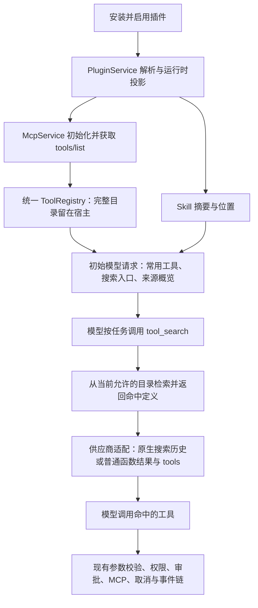

# 按 Codex 设计插件与工具加载

状态：设计方案，尚未实施。查证日期：2026-10-13。

基线：本系统 `35026a3`；本地 Codex 参考仓库 `a20fe6335f960a350483d0079db2ec281c68202c`。本文以本地 MCP 插件为主，不把远程 Apps、Portable AgentPlugin 的特殊政策推广到所有插件。

## 1. 设计决定

安装并启用插件后，宿主将插件的 Skill、MCP 等能力投影到已有子系统。MCP 工具进入统一工具注册表；模型初始只看到常用工具、搜索入口、来源概览和 Skill 摘要。模型根据任务搜索，宿主返回命中工具的完整定义，再通过已有执行链调用。

**插件不是必须先调用的工具入口。用户无需每条消息点名 REA，也无需为每个插件添加主系统代码。** 对支持原生工具搜索的供应商，定义通过 Codex 式搜索结果历史加载；DeepSeek 使用经过适配的普通函数搜索与后续请求工具定义。

三件事分别处理：

| 边界 | 决定什么 | 目标 |
| --- | --- | --- |
| 服务生命周期 | MCP 进程何时启动、连接如何复用 | 首阶段沿用主会话提前连接；子会话缓存启动单独实施 |
| 模型披露 | 哪些定义进入模型上下文 | 默认延迟 MCP 定义，搜索只加载命中项 |
| 执行权限 | 已注册工具能否执行 | 继续走既有权限、风险、审批与沙箱 |

搜索只披露定义，不批准执行。来源概览、Skill 摘要和已加载定义仍占上下文；本方案不承诺零 token 或消除幻觉。

## 2. Codex 源码依据

下列路径相对 `借鉴/codex/codex-rs/`，函数与行号对应上述参考版本。

| 环节 | 源码位置 | 已查证行为 |
| --- | --- | --- |
| 安装与启用 | `core-plugins/src/manager.rs:2250`，`install_resolved_plugin` | 安装插件，并设置用户插件 enabled |
| 刷新会话 | `app-server/src/request_processors/plugins.rs:1462`，`plugin_install_response`；`core/src/thread_manager.rs:831` | 安装后清缓存、重读配置，并使现有会话 MCP runtime 失效待刷新 |
| 加载插件能力 | `core-plugins/src/loader.rs:823`，`load_plugin`；`:1534` | 禁用插件不加载能力；启用插件解析 Skill、MCP、Apps、Hooks 等资源 |
| 合并 MCP 配置 | `core/src/config/mod.rs:1778`，`to_mcp_config_with_loaded_plugins` | 活跃插件 MCP 带归属信息进入统一 ResolvedMcpCatalog |
| 启动策略 | `core/src/session/mcp_runtime.rs:380`；`codex-mcp/src/connection_manager.rs:633` | 主会话 Eager；SubAgent 使用 LazyWhenCached，但实际延迟还要求缓存等条件 |
| 获取目录 | `codex-mcp/src/rmcp_client.rs:951`，`initialize`；`:1016` | 初始化后获取工具目录；缓存目录与连接绑定由 MCP 层管理 |
| 暴露策略 | `core/src/mcp_tool_exposure.rs:85` | 搜索可用时 MCP 为 Deferred，否则 Direct；特殊插件另有预算政策 |
| 原生搜索条件 | `core/src/tools/spec_plan.rs:653`，`search_tool_enabled` | 模型支持 search tool，并且供应商支持 namespace tools |
| 初始请求 | `core/src/tools/spec_plan.rs:554`，`build_model_visible_specs` | 只选 Direct，Deferred 的完整定义不进入初始 tools |
| 来源概览 | `core/src/tools/handlers/tool_search_spec.rs:17`；`core/src/context/world_state/tools.rs:24` | 搜索描述或 world state 展示来源；world state 有预算和增量更新 |
| 搜索语料 | `core/src/tools/handlers/mcp.rs:541`，`build_mcp_search_text` | 包含工具名、来源、插件展示名、描述与 schema 属性名 |
| 搜索实现 | `core/src/tools/handlers/tool_search.rs:132`、`:246` | BM25 检索已备目录；命中定义按 namespace 合并；目录未变时可复用索引 |
| 定义加载 | `tools/src/tool_search.rs:20`，`to_loadable_spec` | 只物化命中的定义，设置 defer_loading 等原生协议属性 |
| 历史输出 | `core/src/tools/context.rs:241`，`ToolSearchOutput::to_response_item` | 完整命中定义进入原生 ToolSearchOutput，并经既有工具结果路径进入历史 |
| 执行 | `core/src/tools/handlers/mcp.rs`，`McpHandler::handle` | 走统一 MCP 调用、当前绑定、审批及 Hooks |
| Skill 与插件使用 | `ext/skills/src/render.rs`；`core/src/context/available_plugins_instructions.rs:41`；`core/src/plugins/render.rs` | 摘要目录与正文分离；通过插件底层能力使用；显式提及提供提示 |

由此得到的约束：

1. 主机知道全部工具，与模型收到全部定义是两回事。
2. 不需要先调用 `activate_rea` 才能检索 REA。Codex 搜索 handler 检索已有目录，不承担插件激活或服务启动。
3. Codex 原生搜索返回完整定义，通过历史参与下一次推理；它不等价于普通工具返回几个名称后，任意重建初始 tools 数组。
4. Codex 的来源概览有不同配置路径：搜索入口描述 Include，或启用 DeferredToolWorldState 后 Omit 并交给上下文状态。不能双重注入，也不能把某一 feature 的行为说成所有模式的默认。
5. 搜索不是授权门。Codex router 可以路由已注册的 Deferred 工具，执行仍须独立检查权限。

参考测试已阅读，未在本轮运行 Codex：`spec_plan_tests.rs::mcp_and_tool_search_follow_direct_and_deferred_tool_exposure`、`handlers/tool_search.rs::mixed_search_results_coalesce_mcp_namespaces`、`core/src/tools/context_tests.rs` 的原生搜索结果测试，以及 `codex-mcp/src/connection_manager_tests.rs::capture_binding_exposes_cached_tools_before_startup`。

## 3. 本系统现有边界与差距

| 已有实现 | 可以复用 | 需要收敛的差距 |
| --- | --- | --- |
| `PluginService` 与 `PluginRuntimeProjection` | 安装、启用、缓存失效、资源与运行 SDK 投影 | 来源信息有 plugin_id/name，但尚未贯穿搜索；不能从命名空间字符串猜归属 |
| `McpService`、`attach_mcp_tools`、`McpRegistry` | 配置 overlay、连接缓存、初始化、目录、失败诊断与 adapter | 增加目录变化后的统一披露快照；服务启动与定义披露分开 |
| `ToolRegistry`、`ToolSpec`、`Tool` | 唯一工具与执行路由 | 搜索是该注册表的只读派生索引，不能成为第二套工具注册表 |
| `tool_manifest.rs` | 来源分组、权限过滤、初始 schema 筛选 | 当前只有来源名称，无描述、预算和增量状态；Auto 小目录仍直接暴露 |
| `ToolSearchTool` | 已有普通函数入口和查询兼容性 | 语料仅名称与描述；结果不是结构化完整定义；直接选择也须受统一预算约束 |
| `ModelAgent::with_tool_schema_source` | 同任务下一次推理可见命中 schema；子运行独立绑定 | 回调捕获注册表与 discovered set；尚未形成目录、结果、历史和供应商能力一致的投影 |
| `ResponseItemAppended`、`run_events`、恢复和压缩 | 同一历史、同一存储与事件顺序 | 没有原生 ToolSearchOutput 类型；不能把新语义先压成普通文本再试图恢复 |
| `ToolsDiscovered` 与 run finalizer | 旧会话的发现名称恢复兼容入口 | 当前仅名称，运行收尾才落发现增量；升级、禁用和途中崩溃不能只靠名称集合判断 |

当前 MCP 初始化 instructions 会按已有逻辑进入上下文。即使隐藏 schemas，过长 instructions 仍可能包含完整工具介绍；必须纳入同一上下文预算，不能把“来源概览很短”当作请求整体很小的证据。

## 4. 目标内部流程

### 4.1 插件安装、启用与目录准备

- 沿用现有插件格式、运行包、RuntimeBroker 和 SDK 版本解析。REA 包无需转成 Rust SDK。
- 启用后将 MCP 配置与 Skill 路径投影到已有服务；插件禁用则撤去相应投影。
- 主会话沿用提前连接的策略，执行 initialize / tools/list，成功工具注册到同一个 ToolRegistry。启动失败保留具体诊断，不将失败来源列为可调用来源。
- 配置变更、插件升级/禁用、目录更新使来源概览、索引和模型投影一起失效；下一模型步骤捕获一致版本，不能分别读取几个变化中的全局集合。
- 当前系统有用户 MCP 优先和插件声明名冲突政策。首阶段保留既有契约并测试诊断；不顺手放开被拒绝的来源，也不静默覆盖工具。

目录版本是宿主内部概念，不新增运行存储。可用现有配置摘要、schema 摘要及注册表快照身份表达；实现时明确哪个快照代表本次模型步骤，不另造一套 catalog service。

### 4.2 来源与工具元数据

搜索记录引用现有 ToolSpec，并关联 MCP ownership 与 PluginMcpServerSource。需要保留的信息：

| 信息 | 用途 | 模型初始是否收到 |
| --- | --- | --- |
| 稳定来源标识、来源展示名、短描述 | 分组、理解用途、搜索 | 预算内的来源概览 |
| 插件身份与展示名、声明名、运行服务名 | 归属、冲突诊断、检索 | 只展示必要的名称与用途 |
| canonical 工具名、服务本地名称、描述、参数属性名 | 检索与确定工具 | 否 |
| 完整参数 schema、schema 摘要、目录身份 | 命中定义、版本校验与恢复 | 否；命中后披露定义 |
| 风险、权限、allowlist 与运行范围 | 披露过滤及执行检查 | 只提供必要的能力提示 |

不通过拆 `mcp__...` 或 `__` 推导归属。原始配置路径、环境变量值、headers、凭据及完整服务指令不进入搜索语料。

来源短描述优先使用已经解析的插件 manifest 用途，并关联服务名；用户配置 MCP 使用已有可用说明。没有说明就保留名字，不自动编造描述，不新增必须填写的插件字段。

### 4.3 来源概览与 Skill

- 采用 Codex world state 的预算与增量方式：来源渲染片段最多 4 KiB，描述取首行、最多 250 字符，UTF-8 安全截断，稳定排序并明确省略。大量来源时仍可对完整允许目录搜索。
- 来源概览放在现有上下文来源中，搜索工具的描述只解释如何搜索，避免两处重复列目录。
- 目录未变化不追加相同块；新增、删除和描述变化发送 delta。恢复及压缩后先建立完整基线，再应用增量，不能认为被压缩掉的旧公告仍在模型上下文中。
- 来源仍有可检索工具时保留概览；找到该来源的一个工具，不等于已加载该来源全部工具。
- Skill 初始只展示名称、摘要和位置；需要时经已有 Skill 加载链读取正文。显式提及插件提供来源/Skill 提示，普通任务也可依据摘要自动选择。
- 服务 instructions 保留其外部内容属性并纳入预算。按选中来源披露细节、避免初始长指令枚举工具，是**本地上下文适配设计**；不能冒称已由 Codex 上述来源目录代码证明。

4 KiB 和 250 字符来自 Codex world state；Codex 搜索工具描述另一条路径使用 512 KiB 上限，本系统采用前者。省略只影响提示，不能删除宿主可搜索工具。

### 4.4 搜索、完整定义与状态更新

1. 从同一目录快照取得符合运行 profile、权限和 allowlist 的工具；在构建索引前过滤。需要审批但在运行授权范围内的工具仍可被发现，发现本身不代表审批通过。
2. 按 Codex 构造丰富搜索文本：工具名、本地名、服务名、插件名、来源说明、工具描述、参数属性名。检索层不调用外部模型，也不启动第二条 REA 执行链。
3. 用 BM25 排序并复用等价目录索引；本系统当前 Cargo.lock 没有 bm25 依赖，实施前须核查候选库、许可证与 Rust 兼容性。算法方案不等于已经选定依赖/API。
4. Codex 参考使用 English tokenizer。中文任务需结合实际 REA 描述检验召回；中文分词或别名属于**本地检索适配设计**，只针对真实失败样本补充，不能原样采用英文分词后宣称支持中文。
5. 结果提供命中名称、来源、说明和完整 schema，并带可验证的目录/schema 身份。内部结构是本地设计数据，不直接当作供应商 wire 字段。
6. 延续当前默认 5、最大 20 的结果上限，所有查询路径统一约束，包括旧 `select:` 兼容路径。另按既有上下文剩余预算控制定义总量；无法容纳单个完整定义时返回明确原因，禁止截断参数 schema 后将其标为可用。
7. 搜索成功结果通过已有工具结果与历史事件路径持久化；在继续下一次推理前完成状态更新，不等到最终收尾才获得唯一恢复依据。
8. 无结果返回空集和可调整的查询提示。不猜名字、不 fallback 到全量加载、不自动切换插件或下载软件。

普通 function 搜索沿用已有公开参数 `query`、`max_results` 和查询语法，避免无关 API 改动；将来原生 provider 使用其已核实的 `query`、`limit` 契约，由适配层映射到同一个内部搜索。不能维护两套索引、排名和权限规则。

## 5. 模型协议适配

### 5.1 当前代码和官方依据

本系统 `deepagent-models/src/client.rs` 已有 Responses 与 ChatCompletions 两种 WireMode：桌面既有默认走 Responses，Harness 有 Chat Completions 路由。因此不能把本系统统一描述成 Chat Completions，也不能仅因接口叫 Responses 就推定支持 Codex 全部原生工具类型。

DeepSeek 官方 [Responses 参考](https://api-docs.deepseek.com/api/create-response/)列明支持的输入 item 与函数工具，其余输入类型及内建工具类型被忽略；[兼容性说明](https://api-docs.deepseek.com/guides/responses_api/)也限定了工具类型。**据此，本设计不启用 DeepSeek 原生 tool_search / tool_search_output，也不以兼容 Responses 推断支持 namespace 或 defer_loading。**

官方 Responses 接口为无状态接口，客户端每次发送完整历史；这意味着已加载定义和历史仍有成本，不能承诺服务端自动记住它们。[依据](https://api-docs.deepseek.com/api/create-response/)

### 5.2 一套发现语义，两种协议投影

| 投影 | 初始请求 | 搜索结果 | 下一次模型请求 |
| --- | --- | --- | --- |
| 原生工具搜索，需能力与实测证据 | Direct 工具、原生搜索入口；Deferred 定义不放初始 tools | 完整命中定义转为 ToolSearchOutput | 通过既有历史携带搜索输出；按 native 契约装载，不能再次重复全量加入 tools |
| DeepSeek 普通 function，当前目标 | 常用函数与普通 tool_search；未命中 MCP 定义不放 tools | 标准函数结果返回名称、来源与加载状态；完整定义保留在内部已验证搜索结果 | Responses 发送相配的 function_call_output，Chat 路由发送对应 tool 消息；tools 加入当前允许且已加载的函数定义 |

普通函数投影避免在结果文本与 tools 中重复发送完整 schema；完整定义由宿主保存并进入下一请求的 tools。仅在工具结果正文中出现 schema，不能作为下一次可调用能力注册的替代。

完整搜索结果以供应商中立的类型进入现有 `ResponseItemAppended` 历史，保留 call_id、命中定义及版本身份；这需要扩展既有核心历史类型，并同步其消费方，属于**本地适配设计**。普通函数 wire 投影将该历史项转成摘要式函数结果，同时据其构建 tools；原生 wire 投影将其转成 ToolSearchOutput。两种投影共用一个持久化事实，UI 的 Message 视图可以显示摘要，但不能成为恢复定义的唯一来源。不另存一份插件发现日志，也不把内部类型名称当作 DeepSeek 请求 item。

供应商能力判定放在 deepagent-models 既有 seam 中，区分普通函数、原生搜索、namespace 与历史加载支持。上述分类是设计概念，不是现有 API 字段。没有证据时走普通函数适配；若连函数工具调用也不支持，则明确报告该模型不能完成工具任务。

原生投影后续实施必须覆盖类型、请求序列化、流式搜索调用解析、工具结果、ResponseItemAppended、恢复、压缩及 UI/CLI 投影。新语义不能因转成 Message 而丢失，也不能将不支持的原生 item 原样发给 DeepSeek。当前默认模型闭环先使用普通函数投影，不为本轮设计扩展供应商或切换默认模型。

### 5.3 已加载状态与上下文

- 既有会话发现状态是普通函数投影的输入，并与当前目录、schema 版本、权限重新求交集；历史名称不是执行授权。
- 同一次任务搜索后，下一次推理即可调用；后续会话轮次沿用有效定义，不按每条消息是否使用而自动卸载。若后续实现预算驱逐，须有独立证据与测试，首阶段不增加该状态机。
- 已加载定义总量仍受上下文预算限制。不能因为它们都是逐次搜索得到，就无限累积并超过请求预算。
- 旧 ToolsDiscovered names 事件可读取并迁移，但恢复时必须通过当前目录验证。新增身份信息若确需进入事件，采用兼容、版本化表示，经全局消费方查证后实现，不另建 discovery store。
- 禁用/升级后不再向新请求投影失效定义；旧历史保留为审计事实，不代表工具仍可调用。旧 native 搜索历史如何清理/重建由原生适配统一处理。

## 6. 生命周期、权限与失败处理

| 情况 | 设计行为 |
| --- | --- |
| 主会话服务启动 | 沿用现有连接/cache，符合 Codex Eager 方向；搜索不是服务启动按钮 |
| 子运行 | 搜索状态、profile、allowlist 独立；复用不可变目录数据，不能共享父运行的可变发现集合 |
| 子会话缓存延迟启动 | 后续按 LazyWhenCached 的完整前提实施：有效目录缓存、非显式要求立即准备的服务、连接触发与故障恢复；首阶段不宣称已实现 |
| 目录更新 | 构建新版本，并统一刷新概览、索引与请求投影；旧索引不用于新目录请求 |
| 搜索与禁用并发 | 当前步骤持有稳定目录，后续调用前检查当前启用/授权状态；已运行调用按既有取消链处理，不因释放共享目录意外中断其他会话 |
| 运行时更换 | 下一步骤绑定新配置；正在执行的调用保持已捕获配置直到完成/取消；审批撤销等权限变化仍执行既有检查 |
| 工具缺失或 schema 改变 | 明确标为失效并要求重新发现；不静默按同名另一插件路由 |
| MCP 连接失败 | 保留现有 lifecycle 降级诊断，已成功来源仍可用；不吞错误，也不为了恢复自动绕过运行环境 |
| 超预算 | 限制披露并明确说明；不裁坏 schema，不暴露全量工具作为 fallback |
| 取消、超时、审批 | 全部复用 AgentKernel 与现有工具执行上下文；不增加插件专属旁路 |

归属、描述、schema、instructions 与工具返回内容来自外部包/服务，均不能授予权限或提升指令优先级。搜索目录和结果在披露前按允许范围过滤，执行时再校验参数、权限和审批。日志记录目录版本、来源、结果数量、加载数量及错误类别，不记录凭据、目标文件内容或完整模型请求。

## 7. 上一轮提交的处理

`35026a3` 是过渡实现；本轮不自动回滚，也不把已有测试通过解释为完成 Codex 对齐。

| 改动 | 后续处理 |
| --- | --- |
| 同一 ToolRegistry、按来源公告、MCP ownership | 保留方向；扩充真实来源描述与插件归属，收敛为统一元数据投影 |
| 父子运行搜索重绑定、权限/profile 筛选 | 保留，并纳入统一快照与状态验证 |
| 同任务下一次请求刷新命中 schema | 保留普通函数适配能力；callback 不再拥有独立披露规则，由已验证搜索结果与 provider 投影驱动 |
| 搜索只匹配名称/描述，返回简单名称列表 | 收敛为 Codex 式丰富索引及内部完整定义结果；普通函数对外参数保持兼容 |
| 无预算来源名称块 | 改为名称、短描述、预算与 delta；来源目录不枚举所有工具 |
| Auto 低于 8000 字符直接加载 | 作为旧配置兼容问题处理；目标默认按可用搜索延迟 MCP，不以目录大小决定默认策略 |
| 收尾持久化发现名称 | 保留旧事件读取；恢复事实来自搜索结果历史，校验目录身份与当前授权 |

目标默认使用 Enabled。现有显式 Disabled 保留“直接提供允许工具”的兼容语义；旧 Auto 迁移到 Enabled，并在已有设置界面/配置更新说明中解释阈值不再参与默认 MCP 披露。迁移只执行一次，需测试设置持久化与所有消费方；本轮没有实施迁移。

这项默认策略是**本地适配设计**：Codex 原生不可用时有 Direct fallback，本系统为满足默认 DeepSeek 下按需使用的目标，保留普通函数搜索适配。它与原生 Codex 协议不同，不能隐藏这一区别。

此前 `307a21d` 的中文路径、MCP 名称路由、结构化结果保留和运行包摘要校验继续保留；这些是独立的通用正确性修复。

## 8. REA 的落地方式

REA 清单、MCP 配置和 Skill 已收敛到内置目录 `apps/desktop/src-tauri/resources/plugins/rea/`；固定运行包的构建输入在 `plugins/rea/runtime/`。桌面构建使用同一制作脚本准备随包产物，用户无需外部安装。沿用该插件包和托管 Node 24.21.0，不增加 REA 专属 host command、代理工具或 Rust SDK。此资源接入不代表本文其余工具加载设计已实施。

以当前实测的 170 个 MCP 工具为例：

1. 用户安装并启用 REA；宿主准备工具目录。模型来源概览展示 REA 的用途与稳定服务标识，Skill 目录提供 `rea-analysis` 摘要；不预先展开 170 个工具。
2. 用户提出“分析这个 ASAR/程序集”。模型可按 Skill 摘要加载操作指引，并搜索对应 REA 能力；用户不必每次点名插件。
3. 宿主返回少量实际命中定义，经 DeepSeek 普通函数适配加载到下一请求；模型使用真实参数指定目标路径。
4. 执行通过现有 MCP adapter；Evidence、错误与结构化结果按既有链保留，权限、审批和取消继续生效。
5. 不相关任务只承担有预算的来源/Skill 提示成本。外部 Ghidra/JDK 等依赖可用性按实际能力验证，不由“工具被发现”推断引擎已能运行。

当前 REA 服务有 retained Evidence 和 active target。搜索状态隔离不等于服务内部目标状态隔离；验证必须覆盖跨聊天使用显式目标路径与 Evidence 归属。服务需要独立会话/连接时，应在现有 MCP 生命周期边界解决，不为 REA 另写执行通道。

## 9. 实施顺序与验收

### 9.1 实施顺序

| 阶段 | 范围 | 退出条件 |
| --- | --- | --- |
| D0：本轮设计 | 源码链路、差距、provider 适配、迁移及测试方案 | 文档与引用核对、diff 检查；不实施运行时改动 |
| D1：统一元数据与披露 | PluginRuntimeProjection / MCP / ToolRegistry 元数据贯通、预算概览、默认模式迁移 | 初始请求没有未发现 MCP 名称/schema；所有来源归属与权限过滤一致 |
| D2：搜索与 DeepSeek 闭环 | 丰富索引、完整内部搜索结果、普通函数投影、现有历史/恢复 | 同任务发现即用，途中崩溃可恢复；命中定义有预算且版本有效 |
| D3：真实 REA 验收 | 真实模型、中文查询、插件禁用/升级、跨聊天 Evidence | AI 从任务自主找到并调用工具，结果及限制可追溯 |
| D4：可选原生与缓存策略 | 已有供应商具备证据时适配 native；必要时完整实现子会话缓存延迟启动 | native 协议与恢复压缩闭环；不影响 DeepSeek 普通函数路径 |

D1/D2 按已有模块小步收敛，不新增第二套 tool registry、run store、event store、审批或取消中心。原生支持和缓存延迟启动各有单独门禁，不拖入 REA 包格式改造。

### 9.2 必须覆盖的验收场景

| 场景 | 可观察的通过标准 |
| --- | --- |
| 首次模型请求 | 170 个 REA 定义留在宿主；请求仅含必要工具/搜索入口和预算内概览；检查 instructions 未变相全量枚举 |
| 来源增长 | 同来源从少量增加到 170 个工具，来源概览不随工具数膨胀；许多来源时有预算和省略标记 |
| 搜索结果 | 只返回命中定义，schema 完整；中文 ASAR、托管程序集任务的真实目标工具在可用结果中 |
| 下一次推理 | 记录实际发送请求：DeepSeek 工具数组出现命中函数，无原生专有类型；原生路径则历史含完整 ToolSearchOutput |
| 来源与重名 | 中文路径、含 `__` 来源、工具同名、服务冲突、插件展示名检索均按注册归属路由或明确诊断 |
| 权限与子运行 | 未获范围的工具不泄露到来源/结果；审批工具发现后仍需批准；子运行不获得父运行可变发现状态 |
| 禁用与升级 | 下一步骤不披露失效能力；旧同名工具不会被误授权；旧 schema 会提示重新发现 |
| 恢复与压缩 | 搜索结果持久化后崩溃可恢复；旧 names 事件兼容；压缩重建有效定义和来源基线；顺序无重复终态 |
| 预算与失败 | 无结果、超大 schema、过长描述、连接失败和取消均有明确结果，不全量 fallback |
| 真实模型与 REA | 使用固定插件、托管 Node 和实际 fixture 完成 JS/ASAR/.NET 分析，证明模型能发现、选择和解释 Evidence |
| 服务生命周期 | 主会话提前连接与缓存复用可观测；未实施子会话延迟启动前不宣称进程按需启动 |

Rust 行为实施后按仓库门禁执行格式检查、相关 crate 测试、workspace 测试与 clippy。涉及设置迁移的 Rust/前端契约时同步消费者并运行 `apps/desktop` 的 `pnpm build`；UI 验证单独记录。真实模型必须独立联调，mock 请求测试和以前 workspace 通过不能代替。

本轮只验证设计文档内容、源码引用与 Git diff。没有运行编译、Rust 测试、Codex 测试、桌面构建或真实模型联调；上述验收均为后续实施门禁。

## 10. 文档关系

- [REA 插件制作方案](rea-plugin-plan.md)：插件包与运行环境。
- [REA 插件验证记录](rea-plugin-validation.md)：已有制品实测范围。
- [插件工具发现现状](plugin-tool-discovery.md)：`35026a3` 过渡实现与当时测试记录。
- 本文：按 Codex 组织能力与按需加载的目标设计；实施后应同步更新现状文档。
