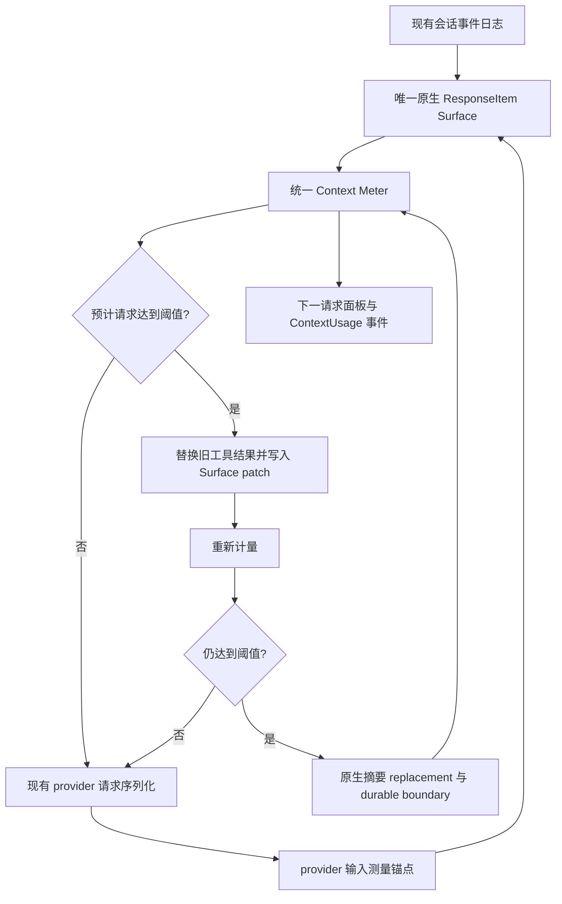

# DeepSeek 上下文工程修复与验收

本次修复把模型请求的历史修改、下一请求计量、自动压缩和面板展示收敛到原生 ResponseItem Surface，继续使用现有会话事件日志与 run_events。

## 使用与兼容

- 面板主值是 `projected_request_tokens / context_window`，辅助值是上一次 provider 输入与实际压缩阈值。累计计费继续使用已有 Usage、RunUsage、CostSummary。
- 旧会话和旧 ContextUsageSnapshot 可读取；没有可核对的 provider 锚点时，完整重测当前 Surface，不冒用以前的测量。
- 历史原始事件保留。新增 `ContextSurfacePatched` 是版本 1 的内部替换事件，无数据库表迁移。较旧程序不认识这个新事件，写入新事件后不应直接降级程序读取该会话。
- 文本与分项仍是估算；provider 不提供分项 token 数，锚定后的分项按本地原生计量比例分配，并保证整数之和等于主值。
- 原生图片使用 DeepSeek 每张 1,024 token 的保守预留，未实施图片尺寸精确计价。附件路径、JSON 引用和 base64 字符长度不会被误当成图片 token。
- 没有修改 DeepSeek 外部请求协议、权限、审批和沙箱路径，没有新增上下文数据库或工具注册表。

## 请求链路



### 原生历史与恢复

`ModelAgent.response_history` 是运行中的请求来源。消息、工具结果、snip、micro compact 和 summary replacement 先修改原生 items，再派生 Message 投影。运行中的裁剪不再通过 Message 反建工具调用。

`ContextSurfacePersistence` 写入现有 Session/EventStore：

```text
ContextSurfacePatched(version = 1, strategy, replacements)
  replacement = source_sequence + call_id + replacement_output
```

写入成功才采用替换。回放按原始事件 sequence 和 call_id 应用 patch，不删除或覆盖原始日志。snip 同样先落盘；完整 tagged segment 才能删除，跨工具调用/结果配对的区间保留。

恢复时先迁移旧日志前缀，再读取后续原生事件，避免新增原生事件后遗失旧对话；第一条原生事件对应的兼容源事件不重复加入。用户标签在完整日志上编号，然后应用 compaction boundary、patch 和 snip，避免重启后编号漂移。

### 计量与锚点

统一计入系统/动态指令、原生消息、reasoning、函数及自定义调用的名称和参数、工具结果、web search、当前可见 schema、附件路由成本。计量在 provider 默认设置投影后进行。

```text
预计下一请求 = 上次 provider prompt_tokens
             + 当前原生 Surface 本地成本
             - 上次请求对应 Surface 本地成本
```

模型、指令、工具 schema 或请求头改变，旧锚点不再用于投影；summary replacement 主动清除锚点。第一版重测完整 Surface。

快照在请求前、provider usage 重新锚定后、assistant 输出、工具结果以及 snip/prune/compaction 更新后发送。运行时 ContextUsage 沿现有 durable sink 进入 run_events。会话详情的可选 `context_usage` 字段读取最新运行的持久化快照，前端在重启后只补齐缺失缓存，不覆盖较新的 live 快照，也不额外发请求。晚于会话回退点或被后续 Surface 编辑淘汰的快照不会恢复。

### 策略

```text
message_budget = context_window - 当前请求输出预留
threshold = min(context_window × 0.8, message_budget - headroom)
```

输出预留取请求的 max_output_tokens；未指定时按模型能力的最大输出预留。没有按模型名前缀设置的 300k 上限。容量、输出、工具预留和阈值共用 ContextBudget 计算。主运行和子运行从 ModelClient 的同一份 provider catalog 能力解析；公开 metadata 优先于按 id 解析的官方快照/保守回退。

| 配置 | 优先级/含义 |
| --- | --- |
| `DEEPAGENT_CONTEXT_HEADROOM_TOKENS` | 新环境变量，最高优先级 |
| `AppSettings.context_headroom_tokens` | 新持久化字段 |
| `DEEPAGENT_AUTOCOMPACT_RESERVE_TOKENS` | 兼容旧环境变量 |
| `AppSettings.autocompact_reserve_tokens` | 兼容旧持久化字段 |
| 默认 | 65,536 |

旧百分比测试覆盖只能降低正常阈值。例如 1,000,000 容量、256,000 输出预留得到 678,464；若输出未指定且模型最大输出为 384,000，则阈值为 550,464。

### 压缩与 usage

停用请求装配前独立按 Message 字符量触发的生产压缩入口。原生循环先剪枝旧的大工具结果，重测后再决定是否摘要。过短结果不会替换成更大的占位文本。

full compaction 与 prefire 使用原生 items 返回 replacement。原生调用参数不经过 JSON 解析/重新编码；并行工具配对和最近尾部保留。摘要须缩小计量成本，且 durable boundary 能定位到本会话事件，才能采用。可证明覆盖被替换区间的持久化 session note 仍可复用。

provider overflow 最多执行一次剪枝恢复和一次原生摘要恢复，再受已有有限请求重试约束。截断回复保留在原生历史及待写入事件中；每个返回 usage 的请求均计费。

Chat adapter 的 prompt_tokens 保留完整输入，不扣 cache hit。cache hit/miss 单列。

## 源码与验证入口

| 证据/问题 | 修复路径 | 验证 |
| --- | --- | --- |
| Message 修改未改变真实请求 | `deepagent-runtime/src/model_agent.rs` | native_prune_changes_wire_and_survives_database_reopen |
| snip 反建丢失工具名称/参数 | `deepagent-runtime/src/snip.rs` | native_snip_preserves_unrelated_tool_pair_metadata |
| native 恢复未应用 snip/patch | `deepagent-app-core/src/input_runtime.rs` | native_response_replay_applies_persisted_snip_without_losing_live_calls、native_response_replay_applies_tool_result_surface_patch |
| 新原生事件遮掉旧日志 | 同上 | upgrading_a_legacy_session_keeps_its_prefix_without_duplicate_native_echo |
| 摘要落盘与 live Surface 不一致 | `deepagent-app-core/src/context_runtime.rs` | native_summary_keeps_exact_tool_metadata_across_replay |
| schema/arguments 未计入压力 | `deepagent-context/src/meter.rs` | native_arguments_alone_can_exceed_a_pressure_threshold、large_tool_schema_triggers_pressure_compaction |
| provider 输入量覆盖下一请求增长 | meter、ModelAgent、ContextCapacityIndicator | provider_anchor_tracks_appends_replacements_and_header_changes、answered_request_republishes_the_snapshot_with_the_providers_numbers |
| 桌面重启丢失上下文快照 | `deepagent-app-core/src/service.rs`、App.tsx | session_detail_restores_the_durable_context_projection、golden_trace_simple_answer_matches_fixture、前端详情加载竞态测试 |
| 300k 前缀策略与别名不一致 | `deepagent-context/src/policy.rs` | one_million_window_with_256k_output_matches_harness_pressure_budget |

在仓库根运行：

```powershell
cargo test --workspace --offline
cargo clippy -p deepagent-context -p deepagent-models -p deepagent-runtime -p deepagent-app-core --all-targets --offline -- -D warnings
cargo fmt --all -- --check
cd apps/desktop
pnpm build
```

前端验证页：`apps/desktop/scripts/context-capacity-verification.html`，使用真实面板组件和明确标注的模拟快照，不发送模型请求。已检查 23.5k → 25k → 8k 的主值变化，上一次请求保持 23k，阈值为 678.5k，各分项之和一致。

验收结果：workspace 2,874 passed / 31 ignored；相关四个 crate 的 all-targets、默认 features、offline clippy 通过；`pnpm build` 通过；修改文件的 rustfmt 检查和 git diff 检查通过。

本次没有调用真实 DeepSeek API，也没有构建/重启 Tauri 桌面安装产物；wire 验证使用捕获真实 serializer 请求体的脚本 transport，数据库恢复验证使用 SQLite 关闭后重新打开。全量 fmt 的已有阻塞位于 `deepagent-runtime/src/kernel.rs:384`。没有运行 all-features clippy。
